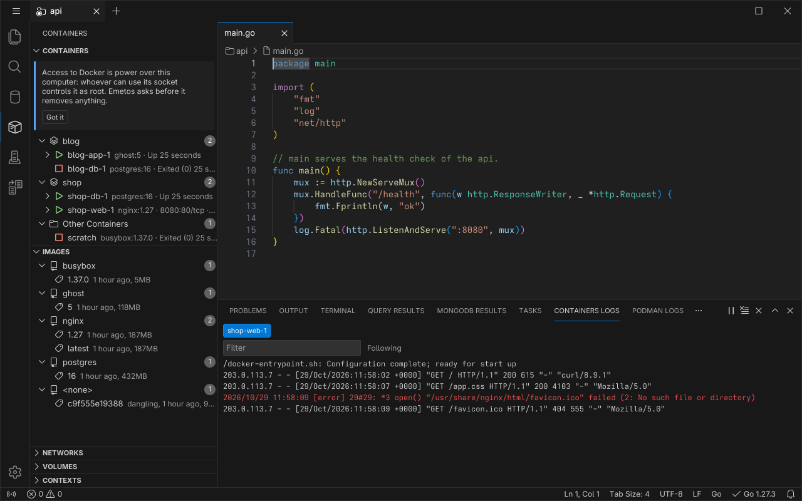
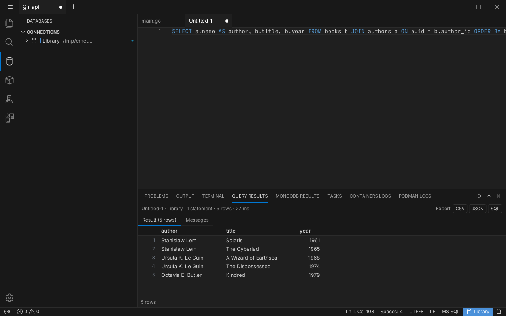
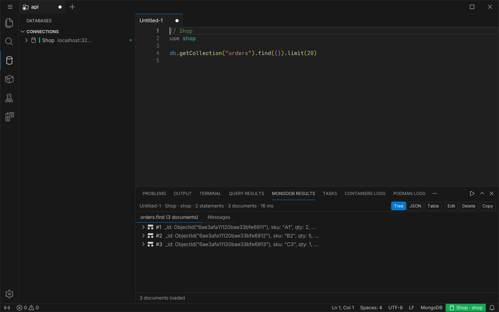
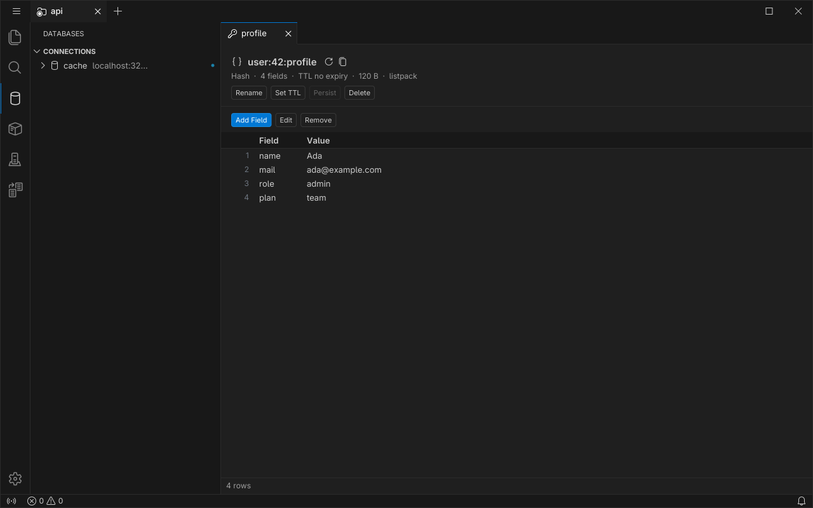

# Emetos

Emetos is a code editor in the spirit of Visual Studio Code, written in Go for the Linux desktop. Its interface is built on [Glutter](https://github.com/rm4n0s/glutter), a GUI toolkit for Go with Flutter's framework API. It is one Go binary: no Electron, no Node.js and no cgo.

It follows VS Code where VS Code has the behavior: the same settings, command ids, color themes, TextMate grammars, snippet files, `settings.json` and `keybindings.json` formats, and VS Code's Linux keyboard shortcuts, so a VS Code user finds their way. Language features (completion, hover, diagnostics, go to definition, rename and more) come from language servers, so the editor itself stays language-agnostic. Emetos has **its own extensions**: Go packages compiled into the program, not VS Code extensions (see [Extensions](#extensions)).


## Status

**The last release is v0.1.0**, which holds areas 1 and 2 of [the specification](docs/SPEC.md) (the editor and the workbench). **`main` is ahead of it** and has no release of its own yet: this README describes `main`. A build of `main` calls itself by Go's version stamp (a pseudo-version), or `v0.1.0-dev` when it has none (`emetos --version`).

What is built (milestones M0 to M22 of [SPEC §18](docs/SPEC.md#18-milestones)):
- **The editor and the workbench** (areas 1 and 2, M0 to M10). [The coverage table](docs/IMPLEMENTED.md#coverage-of-areas-1-2-3-and-11) lists every row of areas 1, 2, 3 and 11 with its tests and what is partial.
- **Extensions** compiled into Emetos, events between them, and event sharing between window tabs (M11, [SPEC §10.15](docs/SPEC.md#1015-extensions-extension-extensions)).
- **Language intelligence through LSP** (area 3, M12, [SPEC §9.12](docs/SPEC.md#912-language-intelligence-area-3-corelsp-corelangfeatures-guieditor-guiviews-extension)).
- **The Go, Remote Work and Relay extensions** (M14 to M16).
- **Containers and databases** (M18 to M22): the **Containers** (Docker) and **Podman** extensions ([SPEC §10.20](docs/SPEC.md#1020-containers-docker-and-podman-extensionscontainers-extensionspodman)), and the database extensions **SQL** (PostgreSQL, MySQL, MariaDB, SQLite and SQL Server, [SPEC §10.21](docs/SPEC.md#1021-sql-databases-extensionssql)), **MongoDB** ([§10.22](docs/SPEC.md#1022-mongodb-extensionsmongodb)) and **Redis** ([§10.23](docs/SPEC.md#1023-redis-extensionsredis)), which share the **Databases** view of the activity bar ([§10.24](docs/SPEC.md#1024-what-the-database-and-container-extensions-share-and-relay)). **Connect to Database** on a container opens the connection form of its database, and Relay clients cannot run the commands of these six extensions.

Experimental: **Remote Work and Relay are new** and have been tested on one machine (instances on loopback, and a simulated lossy link), not yet on real networks. Remote Work's picture is not sharp on a HiDPI screen. Read [their security notes](#remote-work-and-relay) before you turn either on.

Also new: **the container and database extensions** have been tested against fake engines and servers and, one engine at a time, against Docker, Podman and throwaway PostgreSQL, MySQL, MariaDB, MongoDB and Redis servers (SQL Server only against fakes), not against every version of each. Read [their security notes](#containers-and-databases) before you connect them to anything that matters.

Planned, not built: source control, run and debug through debug adapters (the Go extension has no debugger yet), VS Code's `tasks.json` tasks (the Tasks extension runs command lines you list), remote development (SSH remotes and containers), notebooks, the testing UI, multi-root workspaces and settings sync. Language servers other than `gopls` are not bundled (an extension can declare one). The `opencode` agent is not built.

## Build and install

You need **Go 1.27** or newer (`go version`) and `git`. Nothing else: there is no C code, so no C compiler, no system libraries and no `make` are needed to build (what Emetos needs at run time is under [Requirements](#requirements)).

### Build from source

```sh
git clone https://github.com/rm4n0s/emetos.git
cd emetos
go build -tags glutter_release -o emetos ./cmd/emetos
./emetos --version
./emetos .                      # open the current folder
```

`go build` downloads the Go modules Emetos uses the first time. The result is one binary, `./emetos` (about 90 MB), that you can copy anywhere, for example to `~/.local/bin/emetos`.

**Always build with `-tags glutter_release`** for daily use. `glutter_release` is a Go build tag: it compiles [Glutter](https://github.com/rm4n0s/glutter) in release mode, like Flutter's `--release` (`foundation.DebugMode` is `false`, so the framework's debug checks, Flutter's asserts, and its diagnostics are left out of the binary). Without the tag you get a **debug build**: the same program, but those checks make the interface several times slower, and the developer commands of the proofs (`dev.*`) are switched on. A debug build is for working on Emetos itself:

```sh
go build -o emetos ./cmd/emetos          # debug build
go run ./cmd/emetos .                    # build and run a debug build in one go
```

`CGO_ENABLED=0 go build -tags glutter_release -o emetos ./cmd/emetos` gives the same binary without cgo, which also works on a machine with no C compiler at all.

### Install with `go install`

```sh
go install -tags glutter_release github.com/rm4n0s/emetos/cmd/emetos@main
```

This builds `main`, which is what this README describes; `@latest` gives the release **v0.1.0**, which has only areas 1 and 2 (no language servers, no extensions, no Remote Work or Relay). From a checkout, `go install -tags glutter_release ./cmd/emetos` does the same. The program is put in `$(go env GOBIN)`, or `$(go env GOPATH)/bin` when `GOBIN` is not set (`~/go/bin` by default); put that folder in your `PATH`.

### Update

```sh
cd emetos
git pull
go build -tags glutter_release -o emetos ./cmd/emetos
```

`emetos --version` prints the version (a release tag, or a pseudo-version with the commit for a build of `main`), the Go version and the platform.

### Requirements

- Linux with a **Wayland** or **X11** session.
- **Vulkan** or **OpenGL ES 3.0** (Glutter uses Vulkan and falls back to OpenGL ES).
- **fontconfig**, and a **monospace font**: the editor uses the desktop's monospace font and the workbench its UI font. Emetos bundles only its icon fonts.
- Optional: **xdg-desktop-portal** (with a backend for your desktop) for the Open Folder, Open File and Save As dialogs and for opening links. Without it, Emetos asks for the path in its own input box.
- Optional, for the **tray icon**: a StatusNotifier host. KDE Plasma and most panels have one. **GNOME shows no tray icons by itself**: install the AppIndicator extension (for example "AppIndicator and KStatusNotifierItem Support"). Without a tray, the close button of the window quits Emetos instead of hiding it.
- Optional, for the **Go** extension: **`gopls`** on your `PATH` (or its path in `go.goplsPath`), and the Go toolchain. The extension also uses `staticcheck` (lint) and `dlv` (for the debugger, which is not built yet). "Go: Install/Update Tools" in the command palette runs `go install` for them, only when you ask. Without `gopls`, Go files still have syntax highlighting, but no completion, hover or diagnostics.
- Optional, for the **Containers** extension: **Docker** (its engine running and its socket reachable by your user, or `containers.host` / `DOCKER_HOST` / a Docker context pointing at an engine), and the `docker` program for Build, Push, Compose and Open Shell. Optional, for **Podman**: **`podman`** on your `PATH` (Emetos asks a running Podman socket first and otherwise starts `podman system service` itself, on a private socket, nothing to enable in systemd). Without an engine the views say so and do nothing else.
- For the **databases** there is **nothing to install**: the drivers for PostgreSQL, MySQL, MariaDB, SQLite and SQL Server, and the MongoDB and Redis clients, are part of the program (pure Go, no C library). You need a server to connect to (SQLite only a file). Optional: a **Secret Service** keyring (GNOME Keyring, KWallet or another that implements `org.freedesktop.secrets`) to keep a database password between sessions; without one the password is asked when you connect.
- Optional, for **Remote Work** and **Relay**: when you turn them on, they listen on a port, so a firewall must let the other computer reach it: **Remote Work 47123 over TCP and UDP**, **Relay 47124 over TCP** (both can be changed on their pages). Nothing listens until you turn it on. Both need SSH public keys; see [the security notes](#remote-work-and-relay).
- Optional, for **Scan QR Code** (adding a public key with a camera): a camera that Linux shows as a V4L2 device (`/dev/video*`) that your user may open. Without one the button is disabled.

### Launcher entry and icon

`scripts/install-desktop.sh` makes Emetos appear in your application menu and launcher, with its icon. Run it from a checkout of this repository, after installing the program:

```sh
scripts/install-desktop.sh             # install
scripts/install-desktop.sh --uninstall # remove
```

It writes only two things under `${XDG_DATA_HOME:-~/.local/share}`: `applications/dev.emetos.Emetos.desktop` ([the entry](assets/dev.emetos.Emetos.desktop): `Exec=emetos %F`, text files and folders as its types) and the icon in every size of [`assets/icons`](assets/icons) as `icons/hicolor/<N>x<N>/apps/dev.emetos.Emetos.png`. It puts the absolute path of `emetos` in the entry, because a launcher often does not have `~/go/bin` in its `PATH` (`--exec <path>` says which program). It runs `update-desktop-database` and `gtk-update-icon-cache` when they are installed.

## Features

The feature list of [SPEC §3](docs/SPEC.md#3-areas), in short. The first two groups are v0.1.0's; the others came after it.

**Editor**
- Editing: typing, auto-indent and indentation rules of each language, auto-closing and surrounding brackets and quotes, word and word-part deletion, overtype mode (Insert key), indentation detection, tab size and spaces or tabs per file.
- Line commands: move, copy, delete, insert, join, transpose, sort, trim trailing whitespace, change case, line and block comments.
- Multiple cursors (Alt+Click, add next occurrence with Ctrl+D, select all occurrences, column selection), expand and shrink selection, cursor undo, the primary selection of X11 and Wayland.
- Find and replace with regular expressions, match case, whole word, find in selection and preserve case.
- Syntax highlighting with TextMate grammars and VS Code's color themes, for Go, JSON, YAML, Markdown, Python, JavaScript, TypeScript, HTML, CSS, SCSS, Less, XML, SQL, shell, Makefile, Dockerfile, INI, C, C++, Rust, diff, git files and Go module files.
- Bracket matching, bracket pair colorization and guides, indent guides, folding (by indentation and `#region`), minimap, sticky scroll, breadcrumbs.
- Snippets in VS Code's syntax (your own files, tab-completion) and Emmet abbreviations for HTML and CSS.
- Diff editor (side by side and inline, with character-level changes) and a three-way merge editor with accept incoming, current or both, usable from `git` through `--diff`, `--merge` and `--wait`.
- Encodings, LF and CRLF line endings, byte order marks, read-only files, files that change on disk, large files (a 200 MB file opens in seconds), and binary files (refused with a notice).
- Save, Save As, Save All, auto save, hot exit (unsaved changes, also of untitled files, come back after a restart or a crash), and an undo history per document.

**Workbench**
- Menus, activity bar, side bar, editor area, panel and status bar; each can be hidden and the sizes are remembered. Zen mode, full screen, zoom and a centered layout.
- Editor groups in a grid (split in any direction, move and copy editors, maximize), tabs with preview, pinned and dirty editors, drag and drop, and Ctrl+Tab to switch editors.
- Explorer with file watching, `files.exclude`, new, rename, delete to the trash, cut, copy, paste, drag and drop (also from your file manager), and an Open Editors section.
- Command palette (Ctrl+Shift+P), quick open (Ctrl+P) with fuzzy search, go to line (Ctrl+G), back and forward through your edit locations, reopen closed editor.
- Notifications, and the Output and Problems panels (Problems shows what language servers and tools report).
- An integrated terminal in the panel, as VS Code's: see [Terminal](#terminal).
- Color themes (the six VS Code defaults, your own in `themes/`, and following the desktop's dark or light mode) and the Seti file icon theme.
- A settings editor (Ctrl+,) and a keyboard shortcuts editor (Ctrl+K Ctrl+S), both editing the JSON files and keeping your comments, and profiles (named sets of settings, keybindings and snippets).
- The window comes back as you left it: layout, editors with their cursors, scroll positions and folds, and the open folders.

**Search** ([SPEC §10.27](docs/SPEC.md#1027-search-internalcoresearch-extensionssearch))
- Find and replace in the files of the folder, as VS Code's Search view does: Ctrl+Shift+F (seeded with your selection) and Ctrl+Shift+H, with Match Case (Alt+C), Match Whole Word (Alt+W), regular expressions (Alt+R) and Preserve Case (Alt+P), and the boxes "files to include" and "files to exclude".
- The results show while you type, as a list or a tree of folders (`search.defaultViewMode`), with F4 and Shift+F4 to open the next and the previous match. `files.exclude`, `search.exclude` and your `.gitignore` files are honored, and the text of an editor with unsaved changes is searched instead of its file.
- Replace one match, one file or everything (Ctrl+Alt+Enter, after a question); an open file changes in one undo step, and a click on a match while the replace box has text shows the file with its replacements in the diff editor. Find in Folder... is in the Explorer's context menu.
- The engine is Emetos's own Go code (no `rg`), and it searches a generated tree of 20,000 files and 500 MB faster than `grep -rF` ([docs/PERFORMANCE.md](docs/PERFORMANCE.md)). Extensions reach it with `api.Workspace().FindTextInFiles`.

**Containers and databases** (extensions; [Containers and databases](#containers-and-databases) below, and [What is bundled](#extensions))
- **Docker and Podman**: a view of the containers (grouped by Compose project or pod), images, networks, volumes and contexts, with start, stop, logs in the panel, inspect, shells, build, Compose and push, and Add Docker Files to Workspace.
- **Databases**: one **Databases** view (the cylinder in the activity bar) for SQL, MongoDB and Redis connections. A **SQL** editor with the results in a panel, MongoDB **playgrounds** (`.mongodb`), and a Redis **key editor** and console.
- **Connect to Database** on a container of `postgres`, `mysql`, `mariadb`, `mongo`, `redis` or `valkey` opens the connection form filled from its published port and environment (never a password).

**Language intelligence** ([SPEC §9.12](docs/SPEC.md#912-language-intelligence-area-3-corelsp-corelangfeatures-guieditor-guiviews-extension)), from language servers over LSP 3.17 and from providers that an extension writes in Go. VS Code's commands, keys and settings:
- Diagnostics as squiggles and in the Problems panel, with F8 and Shift+F8 to step through them.
- Completion (the suggest widget with its details pane and snippets), hover, and signature help.
- Go to Definition, Type Definition, Implementations and References (F12, Shift+F12), with the peek view; document highlights.
- Find All References and Find All Implementations (Shift+Alt+F12, and the right-click menu of a method or a variable): the results fill a References view in the side bar, by file, with F4 and Shift+F4 to walk them and a history of the searches ([SPEC §10.28](docs/SPEC.md#1028-references-extensionsreferences)).
- Symbols: the Outline view, symbols in the breadcrumbs and sticky scroll, Go to Symbol in the file (Ctrl+Shift+O) and in the workspace (Ctrl+T).
- Code actions (the light bulb, Ctrl+.), formatting (on demand, on save, on type and on paste), organize imports on save, and rename (F2) across files, with a preview.
- Code lens, inlay hints, semantic tokens, folding ranges and selection ranges from the server.
- The only server bundled is `gopls`, through the Go extension. Another language needs an extension that declares its server.


## One window, workspace tabs and the tray

Emetos has one window. Every folder you open is a **workspace tab** in the strip at the top of the window (the folder name, a dot when it has unsaved changes, and a close button). Tabs switch with Ctrl+Alt+PageUp and Ctrl+Alt+PageDown, Ctrl+Alt+1 to 9, or a picker, and can be dragged to a new order. Tabs that are not shown keep running (their files, watchers and auto save).

`emetos <folder>` reaches the running Emetos and opens or focuses that folder's tab. When the window's close button is pressed and a tray is available, the window **hides to the tray icon** and Emetos keeps running; click the icon to bring it back, or use its menu to choose a tab, open a folder, or quit (`window.closeToTray` turns this off). The tabs, their editors and the window come back when you start Emetos again.


## Extensions

Emetos's extensions are **Go packages compiled into the program** ([SPEC §10.15](docs/SPEC.md#1015-extensions-extension-extensions)). There is no plugin loading, no marketplace and no Node.js host, and VS Code extensions do not run in Emetos. Adding one is adding its folder under `extensions/` and one line to `extensions/all.go`, and building Emetos again. An extension that fails (an error or a panic) is switched off for that tab, with a notification and a log entry; the rest of Emetos goes on. The page **Extensions** (Ctrl+Shift+X) lists them, with their state and a Disable button (`extensions.disabled`).

An extension contributes any mix of **seven kinds of contribution**, each drawn inside the box Emetos gives it:
- **Window tab**: a tab in the strip beside the workspaces (Remote Work, Relay).
- **Side bar view**: an activity bar icon with views (Search, References, Containers, Podman, Databases).
- **Panel view**: a tab of the bottom panel beside Problems and Output (Tasks, Go Tests, the container logs, the SQL and MongoDB results, the Redis console).
- **Editor tab**: a tab in the editor area that is not a file (the Remote Work page, a database connection form, a Redis key).
- **Editor title action**: a small icon at the right end of a tab strip (Open Preview to the Side).
- **File view**: micro-tabs inside a file's tab for the files an extension declares (the Markdown preview next to Text).
- **Contributions to the built-in parts**: Output channels, Problems markers, status bar items and notifications.

Beside these, an extension can add commands, keys, menu items, settings, language packs (grammars, themes, snippets) and language servers. Extensions talk to each other only through **events** (publish, subscribe, request and reply), and they only see the events of their own tab. **Event sharing**: events cross from one window tab to another only along a link that **you** allow, in one direction, asked in the receiving tab (Allow, This Session Only or Deny) and kept in `event-sharing.json`. The page **Extensions › Event Sharing** lists the links, removes them, and marks a workspace **private**, which sends nothing out. No settings file can create a link.

**What is bundled:**
- **Language packs**: the 22 languages of [SPEC §8.1](docs/SPEC.md#81-languages-corelanguage) (Go, JSON, YAML, Markdown, Python, JavaScript, TypeScript, HTML, CSS, SCSS, Less, XML, SQL, shell, Makefile, Dockerfile, INI, C and C++, Rust, diff, git files and Go modules).
- **Search**: VS Code's Search view, find and replace in the files of the folder, above.
- **Terminal**: shells in the panel, below.
- **Tasks**: a panel tab that runs the command lines you list in `emetos.tasks.commands` in the folder, shows their output and puts their errors in Problems. (It is not VS Code's `tasks.json`.)
- **Containers** (Docker): a side bar view of your Docker containers (grouped by Compose project), images, networks, volumes and contexts, with Start, Stop, Restart, Pause, Kill, View Logs (in the panel), Inspect, Open in Browser, Run Command, Explore Files, Run, Run Interactive, Pull, Tag, Push and Remove, Open Shell (in the Terminal), Build Image and Compose (Up, Up with chosen services, Down, Restart, Logs; also on a Compose project of the view) through your `docker` program, and Add Docker Files to Workspace (Go, Node.js, Python, .NET or a plain image); the Dockerfile and Compose language servers are used when they are on your `PATH`. It talks to the engine's socket (`containers.host`, `DOCKER_HOST`, your Docker context). **Access to the Docker socket is power over the computer** (whoever can use it can read and change any file as root), and Emetos asks first, with the count and the size, before it removes or prunes anything. [SPEC §10.20](docs/SPEC.md#1020-containers-docker-and-podman-extensionscontainers-extensionspodman).
- **Podman**: the same view and actions for Podman (the extension "Podman", its own icon in the activity bar), with what only Podman has: **pods** (the containers grouped under their pod, a Pods view with Start, Stop, Restart, Pause, Remove and Prune, Create Pod, and Create Pod from Selected Containers), **connections** (`podman system connection list`, rootless and rootful, and a pick of the engine to use), **Generate Kube YAML** (`podman kube generate`, opened as an untitled YAML editor), **Play Kube** and **Kube Down** (`podman kube play` and `down`, which asks first), and **Generate Quadlet** (a `.container` unit for systemd opened as an untitled editor: Emetos writes nothing to `~/.config/containers/systemd` and never runs `systemctl`). Build, Push, Compose (`podman compose` or `podman-compose`) and Open Shell go through your `podman` program. When no Podman socket answers, Emetos starts a `podman system service` of its own on a private socket and stops it when it ends, so nothing has to be enabled in systemd. [SPEC §10.20](docs/SPEC.md#1020-containers-docker-and-podman-extensionscontainers-extensionspodman).
- **References**: VS Code's references view. Find All References and Find All Implementations list the places a language server finds, by file, in a side bar view with a history of the searches.
- **Markdown preview**: a Preview micro-tab for Markdown files, and Open Preview to the Side.
- **Go**, **Remote Work** and **Relay**, below.
- **Databases**: the shared part of the three database extensions: the **Databases** view (an activity bar icon) with the connections of every engine, the connection form, `db-connections.json` and the results grid. [SPEC §10.24](docs/SPEC.md#1024-what-the-database-and-container-extensions-share-and-relay).
- **SQL**: PostgreSQL, MySQL, MariaDB, SQLite and SQL Server (pure Go drivers, nothing to install), their schema in the Databases view, SQL editors and a results panel, below.
- **MongoDB**: MongoDB connections, a browser for databases, collections, indexes and schemas, and **playgrounds** (`.mongodb` files), below.
- **Redis** (and Valkey and compatible servers): connections (URL, ACL user, TLS, Sentinel, Cluster, a database number, read-only), a browser for the keys, a key editor, a console, Pub/Sub, Monitor and server information, below.


The Notes, TODOs and Scratchpad extensions of earlier versions are gone. What you wrote in a note or in the Scratchpad is saved once, at the first start, as Markdown files in `$XDG_DATA_HOME/emetos/saved-notes/` (`~/.local/share/emetos/saved-notes/` by default), and a notification offers **Open Folder** ([SPEC §10.26](docs/SPEC.md#1026-removed-notes-todos-and-scratchpad)).

### Terminal

The **Terminal** tab of the panel (Ctrl+` shows it, and hides the panel again while the terminal has the keyboard) runs your shell in a pseudo-terminal, with VS Code's commands, keys, settings (`terminal.integrated.*`) and colors (`terminal.*`). It is Emetos's own: an emulator written in Go and a grid drawn from a glyph atlas with two draw calls (no web view, and nothing of xterm.js), so that `cat` of a 100 MB file takes about as long as in a fast native terminal (`docs/PERFORMANCE.md`).
- **Several terminals.** Ctrl+Shift+` makes another, Ctrl+Shift+5 **splits** the one you are in (side by side, with a draggable divider), and the **tabs list** at the right shows when there are two or more (`terminal.integrated.tabs.*`): click a row to switch, middle-click or the trash button to kill, the secondary button for the menu. The shell starts in the folder of the workspace (`terminal.integrated.cwd`), from `terminal.integrated.defaultProfile.linux` or your `$SHELL`; the profiles are listed under the chevron.
- **Keys.** Every key goes to the program, except the commands of `terminal.integrated.commandsToSkipShell` (VS Code's list: Ctrl+P, Ctrl+Shift+P, Ctrl+Tab, F5 and so on stay Emetos's; add or take away with a `-`). Ctrl+Shift+C copies the selection, Ctrl+Shift+V pastes (as a bracketed paste when the program asked for it, with VS Code's warning for several lines), Shift+Insert pastes the primary selection, Shift+PageUp, Shift+Home and the mouse wheel scroll back, a double click selects a word and a triple click a line. Programs that track the mouse get it; hold Alt or Shift to select anyway.
- **Find, links and commands.** Ctrl+F searches the scrollback (case, whole word, regular expression, F3 and Shift+F3, Enter in the box goes to the previous match as in VS Code). Web addresses, `path:line:col` file names (under the workspace folder) and OSC 8 hyperlinks are underlined under the pointer and open with Ctrl+click. **Run Selected Text** and **Run Active File** send the editor's text or file to the terminal, **Send Sequence**, **Rename** and **Select Default Profile** work as in VS Code, and Ctrl+Shift+F with text selected in the terminal searches the workspace for it in the Search view.
- **In the editor area.** *Move Terminal into Editor Area* (and *Create New Terminal in Editor Area*, or `terminal.integrated.defaultLocation` set to `editor`) makes a terminal a tab beside your files; drag a row of the tabs list onto the editor area (the middle of it, a tab strip, or an edge to split) for the same. It is the same shell and the same screen, and *Move Terminal into Panel* sends it back. Closing the tab ends the shell; Ctrl+W does it from the keyboard.
- **The tabs list.** Drag a row to put the tab elsewhere in the list, hover for the process, its id and its folder, *Change Icon...*, *Change Color...*, *Rename...*, *Join Terminals...*, *Unsplit Terminal*, *Kill All Terminals* and *Toggle Size to Content Width* (Alt+Z: a wide terminal that scrolls sideways) are in the right-click menu and the palette.
- **Sessions come back.** When Emetos ends, each terminal's name, icon, color, folder and last 100 lines are kept in the window's state file (only you can read it: mode 0600; it holds whatever your programs printed), and the next start shows them again, a line saying *History restored*, and a new shell in the same folder. The old processes end with Emetos. `terminal.integrated.enablePersistentSessions` (or `persistentSessionReviveProcess` set to `never`) turns it off, and `persistentSessionScrollback` sets the lines.
- **Looks.** The font follows `editor.fontFamily` or `terminal.integrated.fontFamily`, true color, bold, italic, underline styles, wide characters and emoji, box-drawing and block characters drawn to fill the cell, the cursor styles, the scrollbar, and the colors of the theme.
- **IntelliSense.** With shell integration (bash, zsh, fish or pwsh, on by default), **Ctrl+Space** opens a list of what you can type at the cursor, as VS Code's terminal does: the commands of your `PATH` and the shell's builtins, the subcommands and options of the commands Emetos knows (`git`, `npm`, `go`, `ls`, `tar`, `curl` and about 45 more), files and folders, and lines of your history. Down, Up, Tab and Enter choose and accept, Escape closes. To have it open as you type, set `terminal.integrated.suggest.quickSuggestions` (`commands` and `arguments` to `"on"`), as in VS Code; `terminal.integrated.suggest.enabled` turns it off. It reads files and folders only and never runs a program to find its answers.


### Go

The **Go** extension ([SPEC §10.17](docs/SPEC.md#1017-the-go-extension-extensionsgolang)) starts `gopls` for each Go workspace (settings under `go.gopls`, **Go: Restart Language Server**) and adds: Go commands (add or remove struct tags, fill a struct, generate unit tests, toggle the test file, run), tests with run test lenses above test functions and a Go Tests panel, `go vet` and `staticcheck` or `golangci-lint` on save into Problems, and a status bar item with the Go version and the state of `gopls`. Debugging is not built.

## Containers and databases

Six extensions ([SPEC §10.20](docs/SPEC.md#1020-containers-docker-and-podman-extensionscontainers-extensionspodman) to [§10.24](docs/SPEC.md#1024-what-the-database-and-container-extensions-share-and-relay)) for the things a project runs next to its code. Each talks only to what **you** configured: a container engine, or the databases of your connections.

### Docker and Podman

**Containers** (the Docker extension) and **Podman** have the same view in the activity bar, in the spirit of VS Code's Container Tools: the containers grouped by Compose project (and by pod, for Podman), images, networks, volumes and contexts, with their state, ports and age. A container's menu starts, stops, restarts, pauses and kills it, shows its logs in the panel (following, with stderr in red and a filter), inspects it, runs a command in it or opens a shell in Emetos's Terminal, opens a published port in the browser, and **Connect to Database** (below). Images are pulled, tagged, pushed and removed; Build Image and Compose (Up, Down, Restart, Logs) run through your `docker` or `podman` program, with their output in the panel and the errors of a Dockerfile in Problems. Removing and pruning always ask first, with the count and the size, and Cancel changes nothing. The engine is found from the setting (`containers.host`, `podman.host`), `DOCKER_HOST` or `CONTAINER_HOST`, your Docker context, and the default sockets; no engine means the view says so.



### Databases and connections

The **Databases** view (the cylinder in the activity bar) lists your **connections** of every engine, with a state and a color you choose, and opens the databases, tables or keys below each one when you open it. *New Connection...* has the fields of the engine (host and port, user, database, or a file for SQLite, or a URL; TLS; **read-only**). Connections are kept in `db-connections.json` for every workspace or for one folder ([Where things are](#where-things-are)).

**A password is never written to a file of Emetos.** You choose between asking it each time (kept in memory until you disconnect), the **desktop keyring** (the Secret Service, labelled "Emetos: <connection>"), or an environment variable named in the connection (`${env:NAME}`). A password pasted inside a URL moves to the keyring or to memory.

### SQL

The **SQL** extension connects to **PostgreSQL, MySQL, MariaDB, SQLite and SQL Server** and shows their schema in the Databases view: databases, schemas, tables, views, functions and procedures, and below a table its columns (type, NOT NULL, keys), indexes and foreign keys. The menu of a table opens a statement in a new editor (Select Top 1000, SELECT, INSERT, UPDATE, DELETE, CREATE). A `.sql` editor is bound to a connection and a database (the status bar item): Ctrl+Enter runs the statement at the cursor or the selection, Ctrl+Shift+Enter runs them all, and Cancel stops a running one. There are Begin, Commit and Rollback (the status item is tinted while a transaction is open), a **read-only** connection refuses writes, and destructive statements are confirmed. The results are in a panel, a grid for every result set (only the rows in view are built, so a hundred thousand rows are fine; sort, copy as TSV, export to CSV, TSV, JSON or SQL `INSERT`s), with a Messages tab (rows affected, times, and errors with their place marked in the editor); the editor completes names from the live catalog.



### MongoDB

The **MongoDB** extension ([SPEC §10.22](docs/SPEC.md#1022-mongodb-extensionsmongodb)) adds the engine MongoDB to the Databases view: *New Connection...* asks for a host and a port or a connection string (`mongodb://`, `mongodb+srv://`), the user, TLS and, as you need them, the auth source and mechanism (SCRAM or an X.509 certificate), the replica set, a direct connection and the read preference. Below a connection the view lists the databases (with their size), the collections (with how many documents they have, from the server's metadata), the **indexes** of a collection and its **schema**: the fields and their types, found in a sample of up to `mongodb.schemaSampleSize` documents (100).

A **playground** is a `.mongodb` file with statements in the syntax of `mongosh` (`use shop`, `show collections`, `db.orders.find({status: "open"}).sort({total: -1}).limit(20)`, `db.runCommand({ping: 1})`); Emetos reads them itself, without JavaScript, and says where a statement it does not understand is. **New Playground** in the menu of a connection, a database or a collection opens one with the first lines written, and **Open Collection** shows the first page of a collection. Ctrl+Enter runs the selection or the statement at the cursor and Ctrl+Shift+Enter runs them all, on the connection and the database in the status bar item. The results are in a panel as a **Tree**, **JSON** or a **Table**, with a Messages tab (what each statement returned or changed, errors with their code and place); cursors are read in pages (`mongodb.pageSize`). A document opens as Extended JSON in an editor: Ctrl+S shows the fields that changed and, after you answer, replaces the document; Delete Document asks first. **Create Collection**, **Create Index**, **Drop Collection**, **Drop Index** and **Drop Database** only open a playground with the statement written for you to read and run: the menu never changes the server. A read-only connection refuses writes before anything is sent, and `mongodb.confirmDestructive` asks before a drop, `deleteMany({})` and `updateMany({}, ...)`.



### Redis

The **Redis** extension ([SPEC §10.23](docs/SPEC.md#1023-redis-extensionsredis)) works with Redis, Valkey and compatible servers. A connection is a URL or a host with an ACL user, TLS, a database number, a key separator, **Sentinel** or **Cluster** mode, and read-only. A database lists its keys as a tree split at the separator (`:`), loaded with `SCAN` in pages (`redis.scanCount`, never `KEYS`) with a filter by text or pattern. A key opens in an **editor**: a string (text, JSON or hex), a hash, list, set, sorted set or stream (grids that page and let you add, edit and remove), or a ReJSON value, with Rename, Set TTL, Persist and Delete.



The **Redis** tab of the panel has a **console** (a command line with history, `redis-cli` quoting, completion of command names from the server, replies formatted by type, and a cancel for a blocking command), **Pub/Sub** (Subscribe, PSubscribe and Publish) and **Monitor** (with a warning first), each bounded, with pause and clear, and the **server information** (`INFO`, `SLOWLOG`, `CLIENT LIST`, `MEMORY STATS`). `.redis` files run their lines with Ctrl+Enter. Dangerous commands ask first, and a read-only connection refuses writes.

### Connect to Database

On a container of a database image the extensions know (`postgres`, `mysql`, `mariadb`, SQL Server, `mongo`, `redis` and `valkey`), the menu has **Connect to Database**: the connection form opens already filled with the host, the published port and the user and database of the image's environment, never a password.

### Security notes of containers and databases

- **Access to the Docker socket is power over the computer.** Whoever can use it can read and change any file as root. Emetos only uses the engine you point it at, shows a note about this in the view, and asks, with the count and the size, before it removes or prunes anything. **Podman's rootless socket gives only your own power**, but a rootful socket is the same as Docker's.
- **Database passwords are in the desktop keyring or in memory, never in a file of Emetos**, and no connection file with a password in it is accepted. A password never appears in an error or a log, and neither do query text or values: the logs and events carry none. Without a keyring the password is asked, and a warning says so when you asked to save it.
- **A database is power over its data.** Use **read-only** connections (and a database user that can only read) for what you only look at, and read what a statement does before you run it. Emetos asks before the destructive ones, but it does not know what your triggers and procedures do. Do not connect to a server over an untrusted network without TLS.
- **Relay clients cannot run these commands.** The commands of the six extensions reach outside the workspace folder, so [Relay](#remote-work-and-relay) refuses them to a client, with the rest of the commands that leave the workspace.

## Remote Work and Relay

Two extensions that let one Emetos be used from another computer. **Both are new and experimental**, and both are **off until you turn them on**. Both log in over **SSH with public keys only** (no passwords): the computer that is used lists the keys that may log in.

**Remote Work** ([SPEC §10.18](docs/SPEC.md#1018-remote-work-remote-control-of-a-workspace-extensionsremotework)) shows **one workspace of computer A as a window tab on computer B**, and B works in it with its keyboard and mouse. A runs a second view of the workspace, so both see the same documents. On A, the page **Remote Work** (open it with **Remote Work Settings...** in the Sharing menu) turns it on for a workspace, sets the port (**47123**, TCP and UDP), the idle timeout (30 minutes) and the allowed keys. On B, the `+` menu has **Remote Work...**: host, port and a private key file or the SSH agent. The picture travels over QUIC (UDP) and falls back to SSH over TCP when UDP does not get through. Not built: sound, drag and drop between the computers, more than one workspace per session, and a sharp picture on a HiDPI screen (it is drawn at logical pixels).


**Relay** ([SPEC §10.19](docs/SPEC.md#1019-relay-event-control-of-a-workspace-from-another-machine-extensionsrelay)) is event control, not a picture: nothing but events, requests and commands cross the network. In the **Relay** tab (**Relay Settings...** in the Sharing menu), *Be a Host* turns hosting on (port **47124**, TCP), picks the workspaces to share and lists the keys, each **Watch only** (the default) or **Watch and send**. *Hosts* connects to other computers and shows an **Events** panel (a live log of a shared workspace) and, for Watch and send, a **Send** panel (publish an event, make a request, run a command). A client only acts in the workspace it was given, and commands that reach outside it (window tabs, quitting, other folders, profiles, user settings, and the commands of the container and database extensions) are refused.

The **Terminals** panel of the client shows the terminals of the host's workspace, drawn with Emetos's own terminal emulator: you see what they print, live, with their scrollback. It is read-only until the host also checks **Allow terminals** for your key and that workspace (off by default, and never for Watch only); then it takes your keys and pastes, and has New Terminal and Kill. A terminal you typed in shows "Relay: your key's comment" on the host until you disconnect.


### How to host a workspace

The **Sharing** item at the left end of the status bar (the broadcast icon) says whether Remote Work or Relay hosts the workspace: the icon alone when it is not, **Hosting** (with the number of computers connected, "Hosting · 2") on a blue background when it is. Click it to host or to stop.

1. **Add the key.** Click the item, choose **Host with Remote Work** (or **Host with Relay**). With no key listed, the page (or the tab) opens at its guide: paste the public key of the computer that will connect (the contents of its `id_ed25519.pub`), choose the `.pub` file, or Scan QR Code.
2. **Turn it on.** Choose **Host with ...** again (or check **Host this workspace** on the page). The guide gets a check mark for each step, and the item says Hosting.
3. **Connect from the other computer.** The guide lists the addresses of this computer with the port, each with a Copy button, and the fingerprint of the host key to compare the first time. On the other computer, the `+` menu has **Remote Work...** and **Relay**.

The commands are also in the Command Palette: **Remote Work: Host This Workspace**, **Relay: Host This Workspace**, **Sharing: Show Hosting Menu**.

### How to stop

Click the Sharing item and choose **Stop Hosting with Remote Work** (or **with Relay**): the sessions of the workspace end at once, and the other computer reads "The host stopped sharing this workspace." The same is **Stop Hosting** on the banner of Remote Work, the **Stop Hosting** button beside the switch on the page or the tab, and the commands **Stop Hosting This Workspace**. **Disconnect <key>** in the same menu ends one computer's session and leaves hosting on. Nothing listens once nothing is hosted.

### Security notes

Read these before you turn either extension on ([SPEC §10.18](docs/SPEC.md#1018-remote-work-remote-control-of-a-workspace-extensionsremotework) and [§10.19](docs/SPEC.md#1019-relay-event-control-of-a-workspace-from-another-machine-extensionsrelay) have the whole design):
- **A listed key gives that person your power in the workspace**: they can edit and delete files and run tasks (Remote Work, and Relay's Watch and send). List only keys you would trust with your account.
- **Allow terminals gives a client a shell as you.** It is off by default, for every key and every workspace, and you turn it on in *Be a Host* under a key with Watch and send. A client that can type in a terminal can do anything you can do on this computer, and nothing in Emetos limits what a shell does. Relay's Watch only, even without it, sees what your terminals print and the scrollback they hold (not what you type at a password prompt, where the terminal reads a line without echoing it, as `sudo` and `ssh` do; what you type at the prompt of a shell is shown, because the screen shows it as well).
- **Relay's Watch only still sees all document text**: every event of the workspace, including the text and the edits of your documents.
- **Compare the fingerprint the first time.** The first connection shows the host's key fingerprint; compare it with the one on the host's page before you trust it. A connection is only as safe as that comparison. A changed host key is refused with a warning.
- **Over the internet, use a VPN.** The login is as safe as SSH with key-only login, and a VPN is better still. Do not expose the ports to the internet without one. Failed logins are limited to 5 a minute for each address, but that is not a defense by itself.
- You see every login: a banner in the workspace (with Disconnect), a notification, and a log entry. Turning the feature off or removing a key ends the sessions it logged in, and a Remote Work session also ends after its idle timeout.
- No settings file can turn either one on or add a key: only their own pages do. Emetos keeps no private key of yours: it remembers the path of your key file, reads the file when you connect, and asks a passphrase in a dialog without keeping it. The only private keys it keeps are its own host keys (`remote-work-host-key` and `relay-host-key`, mode 0600, see [Where things are](#where-things-are)).

## Command line

```
emetos [options] [folder] [file...]
```

A folder opens as a workspace tab and files open in the active tab. When Emetos is already running, the arguments are handed to it and the command ends.

| Option | Meaning |
|---|---|
| `-g`, `--goto file:line[:col]` | open the file with the cursor at the line (and column); may be repeated |
| `-d`, `--diff a b` | compare two files |
| `-m`, `--merge p1 p2 base result` | merge two versions of a file with their base into the result |
| `-w`, `--wait` | end only when the opened files (or the diff or merge editor) are closed, for `git commit` |
| `-n`, `--new-window` | open in a new tab |
| `-r`, `--reuse-window` | open in the existing tab |
| `--profile name` | use the profile (made empty when it does not exist) |
| `--log level` | log level: `debug`, `info`, `warn` or `error` (default `info`) |
| `-v`, `--version` | print the version and exit |
| `-h`, `--help` | print the help and exit |

Use `--` before a path that starts with a dash. The exit status is 0 on success, 1 on failure and 2 for a wrong command line.

## Where things are

Emetos follows the XDG base directories. `$XDG_CONFIG_HOME` is `~/.config` and `$XDG_STATE_HOME` is `~/.local/state` unless you set them.

| What | Where |
|---|---|
| User settings | `$XDG_CONFIG_HOME/emetos/settings.json` |
| Keybindings | `$XDG_CONFIG_HOME/emetos/keybindings.json` |
| Snippets | `$XDG_CONFIG_HOME/emetos/snippets/` (`<language>.json` and `*.code-snippets`) |
| Color themes (VS Code's JSON or `.tmTheme`) | `$XDG_CONFIG_HOME/emetos/themes/` |
| Workspace settings | `<folder>/.emetos/settings.json` (Emetos does not read `.vscode/`) |
| Other profiles | `$XDG_CONFIG_HOME/emetos/profiles/<name>/` (the same files) |
| Window state, recent lists, backups of unsaved work, logs | `$XDG_STATE_HOME/emetos/` |
| Trash (deleted files) | `$XDG_DATA_HOME/Trash` (the freedesktop.org home trash) |
| Socket of the running instance | `$XDG_RUNTIME_DIR/emetos-<uid>.sock` |
| Event sharing links and private workspaces | `$XDG_STATE_HOME/emetos/event-sharing.json` (mode 0600) |
| Remote Work, host side: its settings and allowed keys | `$XDG_STATE_HOME/emetos/remote-work.json` (mode 0600) |
| Remote Work, host side: this computer's SSH host key | `$XDG_STATE_HOME/emetos/remote-work-host-key` (mode 0600, made when its page first opens) |
| Remote Work, client side: the host keys you trusted | `$XDG_STATE_HOME/emetos/remote-work-hosts.json` (mode 0600) |
| Relay, host side: its settings, shared workspaces, allowed keys and their permissions | `$XDG_STATE_HOME/emetos/relay.json` (mode 0600) |
| Relay, host side: this computer's SSH host key (not Remote Work's) | `$XDG_STATE_HOME/emetos/relay-host-key` (mode 0600) |
| Relay, client side: the host keys you trusted | `$XDG_STATE_HOME/emetos/relay-hosts.json` (mode 0600) |
| Database connections (SQL, MongoDB, Redis), of every workspace or of one folder: name, engine, host, port, user, options, never a password | `$XDG_STATE_HOME/emetos/db-connections.json` (mode 0600) |
| Database passwords you chose to keep | the desktop keyring (Secret Service), labelled "Emetos: <connection>"; never a file |
| The socket of the Podman service Emetos starts when none answers | `$XDG_RUNTIME_DIR/emetos/` (Emetos stops that service when it ends) |

The files of the Event sharing, Remote Work, Relay and database connection rows are in the state folder of Emetos and are the same for every profile; the folder has mode 0700. Only their own pages write them, and **Emetos refuses a file that other users can write** (a private key also one they can read): it does not use it and does not replace it. The saved hosts of the Relay tab and the host and key file of a Remote Work tab are part of the window state. Deleting `remote-work-host-key` or `relay-host-key` makes a new identity, and every client must trust it again.

The files are JSON with comments, in VS Code's formats. "Preferences: Open User Settings (JSON)" and "Open Keyboard Shortcuts (JSON)" open them in Emetos.

## Privacy

Emetos sends nothing about you anywhere: **no telemetry, no crash reports and no update checks.** It uses the network only for what you ask of a feature, and these are the things that do:
- **Remote Work and Relay**: only while you have turned them on, and only with the computers whose keys you listed or whose hosts you saved.
- **Containers and Podman**: only the container engine you configured or that your Docker context, `DOCKER_HOST` or `CONTAINER_HOST` names (a Unix socket on this computer unless you named a `tcp://` address), and the registries your own `docker` or `podman` program contacts when you pull or push.
- **Databases** (SQL, MongoDB and Redis): only the servers of the connections you added, when you connect to them (and, for a keyring, the Secret Service on your own session bus). Result values and query text are never logged and no event carries them.
- **Language servers and tools you install**: `gopls` and the `go` command may download modules as your Go settings say; "Go: Install/Update Tools" runs `go install` when you click it.
- **Links**: a link in a notification opens in your browser only when you click it.

Logs stay on your disk (`$XDG_STATE_HOME/emetos/logs`) and are shown in the Output panel. The camera is read only while the Scan QR Code dialog is open, and no picture of it is kept or sent.

## Screenshots

Every screenshot of this README is made by `scripts/screenshots.sh` (it uses `scripts/proof.sh` in a headless compositor, with isolated settings and state, from the fixtures in `testdata/screenshots/`; the Remote Work and Relay shots run two instances on `127.0.0.1`; the Containers shot runs over a fake Docker engine, and the MongoDB and Redis shots over throwaway servers in labelled containers on `127.0.0.1` that are removed afterwards). The rest:


## Development

[`CLAUDE.md`](CLAUDE.md) has the conventions and the checks, [`docs/SPEC.md`](docs/SPEC.md) is the specification, [`docs/IMPLEMENTATION.md`](docs/IMPLEMENTATION.md) the step-by-step plan, [`docs/IMPLEMENTED.md`](docs/IMPLEMENTED.md) the log of finished steps, and [`docs/PERFORMANCE.md`](docs/PERFORMANCE.md) the measurements. In short:

```sh
go build ./...                  # build (CGO_ENABLED=0 works)
go test -race ./...             # tests; no display or GPU needed
go vet ./... && golangci-lint run
scripts/fetch-reference.sh      # the pinned VS Code sources used for porting (git-ignored)
```

## License

Emetos is released under the MIT License ([`LICENSE`](LICENSE)). It bundles and ports material from other projects, notably Visual Studio Code (grammars, themes, the Seti icons and ported code, MIT), the Codicons icon font (CC BY 4.0: "Codicons by Microsoft Corporation, licensed under CC BY 4.0"), Emmet, vscode-textmate and vscode-go (MIT), and it links Go modules such as Glutter, `quic-go`, `x/crypto` and `gozxing`. [`NOTICE`](NOTICE) lists every asset with its license, and the license texts are in [`third_party/`](third_party/).
