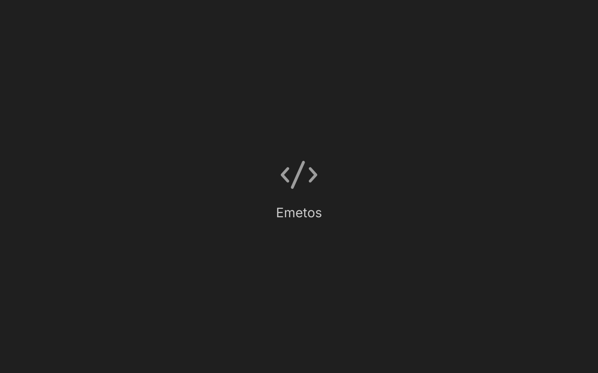

# Implemented steps

This is the log of finished steps from `docs/IMPLEMENTATION.md`, newest at the bottom. An agent adds an entry on the step's branch, as part of the step's commit (`docs/IMPLEMENTATION.md`, rules 12–14). The next step to do is the first step in `docs/IMPLEMENTATION.md` that has no entry here.

## Entry format

Copy this block, fill it in, and keep every heading. Write "none" where something doesn't apply.

```markdown
## <id> <step title>

- **Date:** YYYY-MM-DD
- **Branch:** feat/step-<id>-<slug>
- **Summary:** 2–4 sentences on what now exists and works.
- **Main files:** the packages or files created or changed.
- **Tests:** what was added; the number of VS Code test cases ported and skipped (and from which files).
- **Checks:** gofmt ✅ · go vet ✅ · golangci-lint ✅ · go test -race ✅ · CGO_ENABLED=0 build ✅ · CGO_ENABLED=0 test ✅ · display tests ✅/none
- **Proof:**
  
  One sentence describing what the image shows, as you verified it by viewing it.
- **Manual checks:** the user's answers to the step's manual checks, "pending, see docs/MANUAL-CHECKS.md", or "none".
- **Glutter issues:** entries added to docs/GLUTTER-ISSUES.md, or "none".
- **Deviations and follow-ups:** differences from SPEC or VS Code, and TODOs left for later steps.
```

---

<!-- Entries start below this line. -->

## 0.1 Module and package layout

- **Date:** 2026-10-23
- **Branch:** feat/step-0.1-module-and-package-layout
- **Summary:** The repository has all 44 packages of SPEC §5.2 that the plan fills, each with a `doc.go` that states its purpose and SPEC section, and an empty `cmd/emetos` main. `.golangci.yml` (standard linters plus `revive`'s `exported` and `package-comments`, `reference` and `testdata` excluded) and `internal/archtest` enforce SPEC §5.3: the core never imports Glutter or the GUI, no `net/http`/`net/rpc`/`crypto/tls`, `net` only in `internal/core/ipc`, no `import "C"`, `regexp2` only in `internal/core/regex`, no standard `errors`, no `fmt.Errorf`. `NOTICE` and `third_party/README.md` list the assets and the step that adds each.
- **Main files:** `internal/*/doc.go` (44), `cmd/emetos/main.go`, `.golangci.yml`, `internal/archtest/{archtest.go,archtest_test.go,testdata/}`, `NOTICE`, `third_party/README.md`, `go.mod`, `go.sum`.
- **Tests:** `internal/archtest`: 10 table cases over fixture trees (a clean tree, and one violating tree for each of the 7 rules, a shadowed `fmt` name, and skipped `reference`/`testdata` folders), `TestRepository` (the real repository has no violation), and 2 route tests (`Check.ArchWalkFailed` for a missing root, `Check.ArchParseFailed` for a file that does not parse). No VS Code tests ported (none apply).
- **Checks:** gofmt ✅ · go vet ✅ · golangci-lint ✅ (and it flags an undocumented exported function, checked by hand) · go test -race ✅ · CGO_ENABLED=0 build ✅ · CGO_ENABLED=0 test ✅ · display tests none
- **Proof:** none
- **Manual checks:** none
- **Glutter issues:** none
- **Deviations and follow-ups:** `go mod tidy` removed the `glutter` and `regexp2` requirements because nothing imports them yet; step 0.4 adds `glutter@v1.4.0` and step 4.1 adds `regexp2`. Only the exact package `net` is restricted to `internal/core/ipc`; `net/url`, `net/netip` and the other sub-packages are allowed (they open no connections). The file that does not parse is written to a temporary folder by the test, not committed, because `gofmt -l` recurses into `testdata` and would report it. The `internal/core/ipc` rule will need `net` allowed for the language-server packages when area 3 is planned.

## 0.2 Reference sources and asset scripts

- **Date:** 2026-10-23
- **Branch:** feat/step-0.2-reference-sources-and-asset-scripts
- **Summary:** `scripts/fetch-reference.sh` reads the pins in `scripts/reference-versions.txt` and builds `reference/` (git-ignored): sparse, shallow checkouts of VS Code 1.143.0 (`src/vs`, `extensions`), vscode-textmate, Emmet, vscode-go and the `@vscode/codicons` npm package. A first fetch takes about 23 s and 460 MB (VS Code is 392 MB); a second run takes 16 ms. `reference/go.mod` makes it a separate Go module, so `./...` never sees it. `scripts/check-references.sh` finds 288 `reference/...` paths in the docs and confirms they all exist; `scripts/update-assets.sh` has the copy helpers and no assets yet.
- **Main files:** `scripts/fetch-reference.sh`, `scripts/check-references.sh`, `scripts/update-assets.sh`, `.gitignore`.
- **Tests:** none for Go (the step has none). By hand: a second fetch changes nothing; `check-references.sh` fails with exit 1 and lists the 3 missing paths when a bogus plain path, a `{a,b}` list with one bad name and a `*` glob with no match are added to `docs/SPEC.md` (then reverted); both scripts fail cleanly when `reference/` is missing; `git check-ignore` confirms the ignore; `go list ./...` shows no `reference` package.
- **Checks:** gofmt ✅ · go vet ✅ · golangci-lint ✅ · go test -race ✅ · CGO_ENABLED=0 build ✅ · CGO_ENABLED=0 test ✅ · display tests none
- **Proof:** none
- **Manual checks:** none
- **Glutter issues:** none
- **Deviations and follow-ups:** `shellcheck` is not installed, so the scripts were not linted by it (`sudo dnf install ShellCheck` if wanted). The npm tarball is not checked against its published hash; the pin is the version and URL. In cone mode, git also checks out the files in VS Code's root (`AGENTS.md`, `package.json`...); they are reference data only and nothing reads them. The Rules say to run `scripts/fetch-reference.sh` when `reference/` is missing, so a fresh clone needs about 460 MB and network access once.

## 0.3 Paths and logs

- **Date:** 2026-10-23
- **Branch:** feat/step-0.3-paths-and-logs
- **Summary:** `core/storage` computes every folder from the XDG variables (`Paths`: config, state, cache and data homes, the runtime folder; profile-aware `ConfigDir`/`StateDir`, `CacheDir`, `LogsDir`, `BackupsDir`, `TrashDir`, `SocketPath`), ignoring empty or relative variables as the XDG specification says. `storagetest.Isolate(t)` points `HOME` and all five XDG variables at fresh folders (the runtime folder under a short `/tmp` path, since socket paths are limited to about 100 bytes) and restores them after the test. `core/logs` writes a `slog` logger to `<logs>/<YYYY-MM-DD>/main.log` (folders 0700, files 0600), moves to the new day's file when the clock's date changes, keeps the last 7 days (today included), and mirrors every line into the `Emetos` channel of an in-memory `Store` (last 10,000 lines per channel, subscribers told of each change) that the Output panel will read.
- **Main files:** `internal/core/storage/{paths.go,paths_test.go}`, `internal/core/storage/storagetest/`, `internal/core/logs/{logs.go,store.go,logs_test.go,store_test.go}`.
- **Tests:** 31 table or scenario cases. Storage: paths with every variable, defaults from `HOME`, relative variables ignored, cleaning, `ResolvePaths` from the real environment; profile folders and 7 unsafe profile names on both methods; `Isolate` sets and restores the environment and removes its folders. Logs: file and channel contents, level filtering, append across runs, file modes, rotation at midnight, 5 retention cases, retention leaving non-day entries alone, retention on rotation, a rotation failure keeping the old file, close behavior, 800 concurrent log lines under `-race`; store: order, copies, trimming (6 sizes), subscribers (order, unsubscribe, no lock held), 4,000 concurrent appends. Route tests for all 8 tags: `HomeDirUnknown`, `ProfilePathUnsafe`, `LogDirEmpty`, `LogDirCreateFailed`, `LogFileOpenFailed`, `LogRetentionFailed` (both a failed read and a failed removal), `LogFileClosed`, `LogFileCloseFailed`. Coverage 92%, 83%, 99%. No VS Code tests ported (none apply).
- **Checks:** gofmt ✅ · go vet ✅ · golangci-lint ✅ · go test -race ✅ (also `-count=10`) · CGO_ENABLED=0 build ✅ · CGO_ENABLED=0 test ✅ · display tests none
- **Proof:** none
- **Manual checks:** none
- **Glutter issues:** none
- **Deviations and follow-ups:** `Isolate` also sets `HOME` (the step says only the XDG variables), so code that asks for the home folder can't reach the real one. Logs are 0700/0600, not the usual 0755/0644, because they hold file paths (SPEC G2). `Paths.RuntimeDir` is empty when `XDG_RUNTIME_DIR` is unset: the XDG specification has no default, and step 7.7 decides what the socket does then. A rotation failure keeps logging into the old day's file and puts a `log: rotating the log failed: ...` line in the channel. Profile names are only checked to be a single folder name (`ProfilePathUnsafe`); the naming rules of SPEC §10.12 come in step 8.6. A subscriber of the `Store` must not log through the `Logs` it watches (documented on `Subscribe`).

## 0.4 First window and proof scripts

- **Date:** 2026-10-23
- **Branch:** feat/step-0.4-first-window-and-proof-scripts
- **Summary:** `go run ./cmd/emetos` opens a 1280×800 Emetos window (`dev.emetos.Emetos`) showing the `code` Codicon and "Emetos" on Dark Modern's `#1F1F1F`, with Codicons and Seti loaded through `RunAppOpts.Fonts`; `--version`, `--help` and `--log <level>` work, the log goes to `core/logs`, and cancelling the context (Ctrl+C) exits the app. Glutter v1.4.0 is now a dependency. `scripts/isolated.sh` runs any command with `HOME` and the XDG folders in a throwaway folder (Go's caches and the Wayland socket stay reachable), and `scripts/proof.sh` builds a debug binary and captures a screenshot in a headless sway, isolated, in 7 s (method B; `--output` is method C). `scripts/headless-wayland.sh` and `scripts/screenshot-headless.sh` are adapted from Glutter's. `internal/gui/kit/fonts` embeds the two fonts, exports `Codicon`/`Seti`, `Sources()` and `CodiconIcon`, and a generator turns `codicon.csv` into 630 `Codicon…` constants.
- **Main files:** `cmd/emetos/main.go`, `internal/gui/app/app.go`, `internal/gui/kit/fonts/{fonts.go,codicon_gen.go,internal/gen/main.go}` (+ the embedded `codicon.ttf`, `codicon.csv`, `seti.woff`), `scripts/{isolated.sh,proof.sh,headless-wayland.sh,screenshot-headless.sh,update-assets.sh}`, `third_party/{codicons,seti,glutter}/`, `NOTICE`, `go.mod`, `go.sum`.
- **Tests:** fonts: both fonts load into a test engine and resolve as loaded fonts (including the WOFF), `CodiconIcon`, an icon builds and lays out without framework errors; generator: name conversion (6), generation, 10 error inputs, the collision tag, 3 `run` errors, and a check that the committed `codicon_gen.go` is what the CSV generates and has a constant for each of the 630 rows; app: the home shows the icon and the name, cancelling the context asks to exit once, a cancelled context opens nothing; command line: 8 argument cases, 5 error cases (routes through `parseArgs`), 5 `run` cases, a broken stdout and stderr, the version string; scripts (in `internal/archtest`): `isolated.sh` hides the user's folders and removes its own, keeps Go's caches, copies `--config`, passes the exit status on, rejects 5 usage mistakes, keeps a compositor socket reachable; `proof.sh` rejects 6 usage mistakes. No VS Code tests ported (none apply). Route tests for the tags `ArgsInvalid`, `LogLevelInvalid` and the 6 `Codicon…` tags.
- **Checks:** gofmt ✅ · go vet ✅ · golangci-lint ✅ · go test -race ✅ · CGO_ENABLED=0 build ✅ (Glutter without cgo) · CGO_ENABLED=0 test ✅ · display tests none
- **Proof:**
  
  The dark window with the `</>` Codicon in grey and "Emetos" in the desktop's sans-serif font centered below it, as I saw it by viewing the image (`scripts/proof.sh docs/implemented-proof-images/0.4-first-window.png`; generated twice, byte-identical).
- **Manual checks:** none
- **Glutter issues:** none
- **Deviations and follow-ups:** the Seti WOFF loads in Glutter as it is, so no `scripts/woff2ttf` converter is needed. The tests of the scripts are in `internal/archtest` (it holds the repository's rules) instead of a new package, since SPEC §5.2 has none for them. `isolated.sh` exports `GOCACHE`, `GOMODCACHE` and `GOPATH` and links the compositor socket, as the plan's review asked. `proof.sh` waits 1 s before capturing when `--commands` is given. `app.Run` takes a `ctx` that Glutter's `RunApp` does not: cancelling it posts `ExitApplication` from the first page's state. The window text uses `UIFont()` from the desktop and falls back to `sans-serif`; the headless sway has no desktop font settings, so the proof shows the system's default sans. `cmd/emetos` rejects positional arguments (`ArgsInvalid`) until step 3.1 adds `<file>`. When run normally the log goes to the real `$XDG_STATE_HOME/emetos/logs`; proofs and tests redirect it. The `MESA-EGL: failed to get driver name` lines in headless runs are Mesa's, about the missing GPU of the headless compositor. `shellcheck` is not installed, so the scripts were not linted by it.

## 1.1 Positions and the test helper

- **Date:** 2026-10-23
- **Branch:** feat/step-1.1-positions-and-test-helper
- **Summary:** `core/buffer` has `Position` (zero-based line and byte column; `Compare`, `IsBefore`, `IsBeforeOrEqual`, `Equal`, `Delta`, `With`, `MinPosition`, `MaxPosition`), `Range` (`NewRange` swaps the ends like VS Code's constructor; `IsEmpty`, `SpansMultipleLines`, `ContainsPosition`, `StrictContainsPosition`, `ContainsRange`, `StrictContainsRange`, `Union`, `Intersect`, `CollapseToStart/End`, `WithStart/End`, `RangeFromPositions`, `AreIntersecting`, `AreIntersectingOrTouching`, `CompareUsingStarts/Ends`) and `Selection` (anchor and active end; `Direction` LTR/RTL, `Range`, `Start`, `End`, direction-keeping `WithStart/WithEnd`, `SelectionFromRange`, `SelectionsEqual`). `core/vstest` converts a VS Code position (1-based line, 1-based UTF-16 column) to an Emetos position and back for a given text (`ToPosition`, `FromPosition`), with test wrappers `Pos` and `Range`.
- **Main files:** `internal/core/buffer/{position.go,range.go,selection.go}` and their tests, `internal/core/vstest/{vstest.go,vstest_test.go}`.
- **Tests:** ported from `range.test.ts`: 5 construction cases, 9 `compareRangesUsingEnds`, 9 `containsPosition`, 9 `containsRange`, 7 `areIntersecting` (all 5 test functions of that file, none skipped, 39 cases, run through `vstest` on a plain seven-line text). Emetos's own: position comparison (5), delta, with, min and max; strict contains (position 6, range 4), touching ranges (5), union and intersect (5), collapse and replace an end, selection direction (3), `WithStart/WithEnd` for both directions (4, checked against VS Code's `selection.ts`), `SelectionsEqual`. `vstest`: 20 conversions both ways over ASCII, Greek, CJK, astral-plane text, mixed widths, an invalid byte, empty text and empty lines; 7 `ToPosition` failures and 7 `FromPosition` failures, each with a route test for its tag (`VSLineOutOfRange`, `VSColumnOutOfRange`, `VSColumnSplitsPair`, `LineOutOfRange`, `ColumnOutOfRange`, `ColumnSplitsRune`).
- **Checks:** gofmt ✅ · go vet ✅ · golangci-lint ✅ · go test -race ✅ · CGO_ENABLED=0 build ✅ · CGO_ENABLED=0 test ✅ · display tests none
- **Proof:** none
- **Manual checks:** none
- **Glutter issues:** none
- **Deviations and follow-ups:** VS Code's doc comment on `Range.areIntersecting` says touching ranges intersect, but its code and its test say they don't; `AreIntersecting` follows the code and `AreIntersectingOrTouching` covers the other meaning. `areOnlyIntersecting` (used nowhere in VS Code except `monaco.d.ts`) is not ported. `Range` has no VS Code-style `NewRange` validation of negative numbers; positions are checked against a text where that matters (the piece tree, step 1.1b). The ported range cases have no non-ASCII text, so none needed their byte columns worked out again; the non-ASCII conversions are tested in `vstest` itself.

## 1.1b The piece tree

- **Date:** 2026-10-23
- **Branch:** feat/step-1.1b-piece-tree
- **Summary:** `buffer.New(text)` makes a `Buffer` whose text is a persistent AVL tree of pieces over chunks. `Insert`, `Delete` and `Replace` take byte offsets; `Len`, `LineFeeds`, `Text(start, end)` and `String` read; `Snapshot()` returns an immutable value in O(1) that any goroutine can read while editing goes on. Original text is stored in chunks of at most 64 KiB cut at character boundaries; new text goes to an append-only add buffer made of chunks that double from 4 KiB to 64 KiB. Typing right after the last piece of the add buffer grows that piece instead of making a new one (VS Code's append rule), so typing 3,000 characters leaves one node. Every piece knows its line feeds as a range of its chunk's list of line-feed offsets (as VS Code's pieces hold line starts), so cutting a piece and counting line feeds need no scan; step 1.2 builds the line index on `node.lf` and `chunk.feeds`. The tree is Emetos's own: edits are `split` at an offset, then `join` (the join-based AVL algorithms, with path copying), with no parent pointers and no node changed after it is made.
- **Main files:** `internal/core/buffer/{buffer.go,chunk.go,tree.go,buffer_test.go}`.
- **Tests:** 6 construction cases (empty, lines, multibyte, longer than a chunk, one huge line), chunks never cut a character, 18 edit cases (insert at start, middle, end, in an empty buffer, lines, longer than a chunk; delete the start, middle, end, all, a line feed; replace; typing), 7 error cases with route tests for `OffsetOutOfRange` and `OffsetRangeInvalid` (the buffer is unchanged after each), the fuzz-style test of 40 seeds × 250 random edits (insert, delete, replace, typing; edits may fall inside multibyte characters; pieces of 70,000 bytes) compared with a plain string after every edit, with the tree checked each time (AVL balance, heights, sizes and line-feed counts of every node, no empty piece, line feeds per piece); snapshots taken on the way unchanged at the end; `Text` for every range of a buffer edited three times; balance and height of a tree of about 5,000 pieces and after deleting it all; snapshots keep their text; 400 snapshots read from goroutines while the buffer is typed into (under `-race`); `FuzzEdits` (a 30 s run: 4.8 million executions, no failure). Coverage 99.2%. No VS Code tests ported (this step has none; the VS Code piece tree tests are ported in step 1.2).
- **Checks:** gofmt ✅ · go vet ✅ · golangci-lint ✅ · go test -race ✅ · CGO_ENABLED=0 build ✅ · CGO_ENABLED=0 test ✅ · display tests none
- **Proof:** none
- **Manual checks:** none
- **Glutter issues:** none
- **Deviations and follow-ups:** the pieces keep indexes into the chunk's line-feed list instead of VS Code's line and column pairs, which is the same idea with less to keep in sync. No piece merging or rebalancing of fragmentation: a long session of scattered edits makes many small pieces, as in VS Code; step 1.2's benchmarks will say whether `Insert` needs a faster path for typing (it now does a split and a join of O(log n) nodes per keystroke). `Buffer` is for one goroutine at a time; only `Snapshot` values are shared.

## 1.2 Line index and builder

- **Date:** 2026-10-23
- **Branch:** feat/step-1.2-line-index-and-builder
- **Summary:** a `Snapshot` (and so a `Buffer`, which embeds the current one) answers `LineCount`, `LineContent(line)`, `LineLength(line)`, `LineStart(line)`, `OffsetAt(Position)`, `PositionAt(offset)`, `Text(Range)`, `ValidatePosition`, `ValidateRange`, and iterates with `Chunks()` and `Lines(from)` (range-over-func iterators). The line lookups use the line-feed counts kept in every node and the list of line-feed offsets of each chunk, so each is O(log n) with no scan of text: finding the offset after the k-th line feed goes down the tree by counts, and `PositionAt` counts the line feeds before an offset the same way. `ValidatePosition` follows VS Code's `validatePosition` (a line before the first gives the start of the text, after the last the end; a column outside its line goes to the nearest end), and also moves a column that is inside a UTF-8 sequence back to the start of the character, as VS Code moves out of a surrogate pair. `Builder` (an `io.Writer`) and `NewFromReader(r)` build a buffer in chunks of up to 64 KiB, joining small writes and never cutting a UTF-8 sequence, even when the input arrives one byte at a time. The 1.1b method `Text(start, end)` on byte offsets is now `Slice(start, end)`, so that `Text(Range)` can be what SPEC §6.1 says.
- **Main files:** `internal/core/buffer/{lines.go,builder.go,tree.go,chunk.go,buffer.go}`, tests `{lines_test.go,builder_test.go,vscode_port_test.go,vscode_scripts_test.go,bench_test.go,buffer_test.go}`.
- **Tests:** ported from `pieceTreeTextBuffer.test.ts`: 35 of its 87 cases (the file has no `\r`-free case that needs VS Code's TypeScript harness other than those listed below): 22 scripted insert and delete cases converted by a one-off script (the 9 of 'inserts and deletes', 6 of 'prefix sum', the one of 'offset 2 position', 6 of 'get text in range'), each run on the Buffer and on a plain string with the tree checked and every line and position answer compared with plain-string code after each step; 5 'prefix sum for line feed' cases with their position and offset pairs written again for zero-based positions; 4 'get line content / getContentInRange' cases; the 4 'snapshot' cases through `Replace` and `OffsetAt`. **Skipped: 52**: 5 + 12 + 16 whose texts have `\r` ('\\r bug', 'CRLF', 'centralized lineStarts with CRLF': the buffer holds only `\n`), 4 'random is unsupervised' (random; the seeded random test and the fuzz test below cover them), 7 'buffer api' (`equal`, `getLineCharCode`, `getNearestChunk`: APIs Emetos doesn't have), 5 'search offset cache' and 3 'chunk based search' (search comes in step 11.x). Emetos's own: every line and position answer checked against plain-string code for each edit of the 40 × 250 random edits and each step of `FuzzEdits` (all lines, offsets, positions outside the text and in the middle of characters, ranges, `Chunks`, `Lines(from)` for 6 starting lines); multibyte position validation (11 cases); line access errors with route tests (`LineOutOfRange` for the three methods); `Lines` and `Chunks` stop on `break`; builder: 4 readers (whole, one byte at a time, half reads, data with error) over text with 2-, 3- and 4-byte characters never cut inside a character, chunk sizes, many small writes join into one chunk, empty input, a failing reader (route `BufferReadFailed`), a truncated sequence at the end is kept. `FuzzEdits` ran 30 s with the new checks: 740,000 executions, no failure. Coverage 98.9%.
- **Benchmarks** (100,000 lines of 40 bytes, AMD Ryzen AI Max+ 395, `go test -bench`): `BenchmarkInsertTyping` 348 ns per insert (limit 5 µs) · `BenchmarkInsertTypingScattered` (a new piece every time, up to about 1 million pieces) 3.8 µs · `BenchmarkLineContent` 56 ns per line (limit 2 µs) · `BenchmarkLineContentEdited` (5,000 extra pieces) 249 ns · `BenchmarkPositionAt` 74 ns · `BenchmarkOffsetAt` 31 ns.
- **Checks:** gofmt ✅ · go vet ✅ · golangci-lint ✅ · go test -race ✅ · CGO_ENABLED=0 build ✅ · CGO_ENABLED=0 test ✅ · display tests none
- **Proof:** none
- **Manual checks:** none
- **Glutter issues:** none
- **Deviations and follow-ups:** `Text(start, end)` of step 1.1b was renamed `Slice` (see above). `Chunks` gives strings, which copies each piece (a `[]byte` aliasing the buffer would be faster but could be changed by the caller); step 11.x can add a no-copy form if searching needs it. VS Code's `getValueInRange` on the raw tree reaches past the end of a line to include its line feed when the column is too large; `Text(Range)` validates first, so the range from the start of a line to the start of the next is how to take a line with its line feed. `PositionAt` does not move an offset that is inside a UTF-8 sequence; `OffsetAt(PositionAt(x))` gives `x` only for offsets at the start of a character. The tree was left as it is: the typing benchmark is far under its limit, so no faster path for typing was added.

## 1.3 Columns and boundaries

- **Date:** 2026-10-23
- **Branch:** feat/step-1.3-columns-and-boundaries
- **Summary:** `core/edit` has the column functions of VS Code's `CursorColumns` on byte columns: `VisibleColumn` (walk the grapheme clusters before the column; a tab goes to the next stop, a full-width character or an emoji counts 2, anything else 1, by the cluster's first code point), `ColumnFromVisible` (nearest cluster boundary, the one before on a tie), `StatusbarColumn`, `NextRenderTabStop`, `PrevRenderTabStop` and the `…IndentTabStop` pair; grapheme boundaries (`GraphemeBoundaries`, `NextGrapheme`, `PrevGrapheme`) over go-text's segmenter, which is now a direct dependency in `go.mod` (it was already one of Glutter's); and word navigation on one line with a `WordClassifier` built from `editor.wordSeparators` (`DefaultWordSeparators` is VS Code's): `PrevWord`, `NextWord` (the line-level searches of `cursorWordOperations.ts`, with the kind of word and the class that ended it), `WordAt`, and `PrevWordPart`/`NextWordPart` (snake_case, kebab-case, camelCase, runs of capitals). Step 1.8 builds the cursor movements, which also cross lines, on these.
- **Main files:** `internal/core/edit/{columns.go,graphemes.go,words.go}` and their tests, `vscode_columns_cases_test.go`.
- **Tests:** ported from `cursorColumns.test.ts`, all 7 of its tests: `visibleColumnFromColumn` 47 rows (1 skipped: column 2 of '📚az' is inside a surrogate pair, which has no byte column), `toStatusbarColumn` 44 rows (11 skipped for the same reason), `columnFromVisibleColumn` 63 rows (a row VS Code has commented out was left out), `nextRenderTabStop` and `nextIndentTabStop` 27 rows each, `prevRenderTabStop` and `prevIndentTabStop` 30 rows each; 199 rows run, 12 skipped. The rows were converted once by a script that is not kept, and run through `vstest` (UTF-16 columns to byte columns, and back for the expected columns of `columnFromVisibleColumn`). Emetos's own: tab size below 1; 16 visual-width cases over Greek, CJK, fullwidth Latin, Hangul, emoji, flags, combining accents, joined family emoji, skin tones, tabs, and columns outside the line; a round trip of every grapheme boundary of 8 lines; 15 grapheme boundary tables (ASCII, Greek, CJK, astral, one and two combining accents, CRLF, flags, skin tone, joined family, Hangul jamo, an invalid byte); 16 next/previous grapheme cases; forward and backward walks agree with the boundary list; the 1 KiB window of long lines gives the whole-line answer on a 20 KB random line (300 columns) and a 3,000-mark cluster stays in range; the classifier (17 characters, empty and non-ASCII separators); `NextWord`/`PrevWord` 15 cases; `WordAt` 9; custom separators; word parts forward and backward over 10 lines (checked by hand against VS Code's loops); stops are at character starts and make progress over 5 lines including invalid UTF-8. Coverage 100%.
- **Checks:** gofmt ✅ · go vet ✅ · golangci-lint ✅ · go test -race ✅ · CGO_ENABLED=0 build ✅ · CGO_ENABLED=0 test ✅ · display tests none
- **Proof:** none
- **Manual checks:** none
- **Glutter issues:** none
- **Deviations and follow-ups:** SPEC §6.2 said the status bar shows the visual column plus one; VS Code's `toStatusbarColumn` (and its ported test, where '🎈🎈🎈🎈' reaches column 3 after one emoji) counts every code point as 1, so the SPEC sentence was corrected to say that and `StatusbarColumn` follows VS Code. The grapheme functions segment the whole line up to 4 KiB and a 1 KiB window either side of the column beyond that (a cluster longer than the window is cut), so cursor movement on a minified line stays fast; VS Code instead starts at the offset. `editor.wordSegmenterLocales` (Intl.Segmenter) is not supported: words are never split by a language-aware segmenter. `go mod tidy` moved `github.com/go-text/typesetting` from the indirect to the direct requirements.

## 1.4 Reading files

- **Date:** 2026-10-23
- **Branch:** feat/step-1.4-reading-files
- **Summary:** `fileio.Read(ctx, path, ReadOptions)` reads a file as text: the path is checked first (a pipe, a device or a folder is refused without being opened, so a pipe cannot block; a link to a file is followed), the size is checked against the maximum (256 MB by default, injectable), the file is read in 256 KiB steps with the context checked between them, then the encoding is chosen, the bytes decoded with `golang.org/x/text`, and line endings converted to `\n`. The result holds the text, the encoding id (a UTF-8 mark gives `utf8bom`), `HasBOM`, `LineEnding` (and `Mixed`), `Binary`, `LargeFile` (20 MB or 300,000 lines, injectable) and a `FileStat` (modification time, size, mode). Encoding choice: a byte order mark first (UTF-8, UTF-16 LE/BE); without one, the first 512 bytes with NULs are UTF-16 if every other byte is NUL, else binary (VS Code's `detectEncodingFromBuffer`); with `AutoGuess` a file of valid UTF-8 is UTF-8; otherwise the configured `Encoding` (default `utf8`). `ForceEncoding` ("Reopen with Encoding") makes the configured one win over a mark of another kind, and `AllowBinary` is "Open anyway". Line endings: `\r\n` and a lone `\r` become `\n`, and the file's ending is VS Code's rule (`\r\n` when more than half of the breaks have a `\r`; a file with no break takes `DefaultLineEnding`). `Encodings()` and `LookupEncoding(id)` give the table of VS Code's `SUPPORTED_ENCODINGS` ids, long and short labels and order for the 42 encodings x/text covers. `golang.org/x/text` is now a direct dependency (it was Glutter's).
- **Main files:** `internal/core/fileio/{encodings.go,read.go,read_test.go}`.
- **Tests:** the table (42 encodings, unique ids and increasing order, the 7 dropped ones absent, only `utf8bom` encode-only, the returned slice is a copy); every encoding with x/text reads back a sample it can represent (one per encoding, chosen from 19 words in different scripts); UTF-8 with and without a mark and UTF-16 LE/BE with and without a mark (6 cases); BOM detection (8 byte patterns); NUL detection (8 cases including the 512-byte window); binary refused, "Open anyway", and a NUL after the window; line endings (13 cases: empty, no break with and without a default, LF, CRLF, lone CR, four mixes, trailing CR); invalid UTF-8 bytes; auto-guess (5 cases); force-encoding (4 cases); size and line thresholds with injected limits (8 cases, including at and just below each); the stat (time, size, mode); a symlink; 7 error tags with route tests (`FileNotFound`, `FileIsDirectory`, `FileNotRegular`, `FilePermissionDenied` (skipped when run as root), `FileReadFailed`, `EncodingUnknown`, `ReadCancelled`), plus `FileTooLarge`, `FileBinary` and a context cancelled in the middle of a read; a 1.5 MB file read in several steps. Coverage 95.6% (what is not covered are I/O failures that cannot be made to happen in a test). No VS Code tests ported (`encoding.test.ts` needs VS Code's stream classes; its cases are covered by the tables above).
- **Checks:** gofmt ✅ · go vet ✅ · golangci-lint ✅ · go test -race ✅ · CGO_ENABLED=0 build ✅ · CGO_ENABLED=0 test ✅ · display tests none
- **Proof:** none
- **Manual checks:** none
- **Glutter issues:** none
- **Deviations and follow-ups:** the 7 VS Code encodings dropped because `golang.org/x/text` has no codec: `cp1125` (Cyrillic CP 1125), `cp857` (Turkish CP 857), `big5hkscs` (Big5-HKSCS), `iso885911` (Latin/Thai ISO 8859-11), `koi8ru` (KOI8-RU), `koi8t` (KOI8-T) and `gb2312` (GB 2312). `cp950` (VS Code's id for Big5) uses x/text's Big5. SPEC §6.3's binary rule ("a NUL byte in the first 8 KiB") was replaced by VS Code's own: 512 bytes and the UTF-16 pattern, so UTF-16 files without a mark in the Latin-1 range open as text and others look binary (as in VS Code; "Reopen with Encoding" reads them). `files.autoGuessEncoding` follows SPEC §6.3 (mark, valid UTF-8, the setting), without VS Code's `files.candidateGuessEncodings` and its jschardet guess. Invalid UTF-8 bytes become one U+FFFD each (VS Code's decoder gives one per maximal bad sequence). A file is read whole into memory; the line count for large-file mode is taken after conversion. Writing, the BOM on save and the trash are step 1.5.

## 1.5 Writing files and the trash

- **Date:** 2026-10-23
- **Branch:** feat/step-1.5-writing-files-and-trash
- **Summary:** `fileio.Write(ctx, path, text, WriteOptions)` encodes the text (line ending `\n` or `\r\n`, any encoding of the table, a byte order mark for `utf8bom` and, with `BOM`, for UTF-16), then replaces the file atomically: the bytes go to a temporary file in the same folder, which is given the original's permissions, flushed with `fsync`, closed and renamed over the file, and the folder is synced; a failure at any step leaves the original untouched and removes the temporary file. When the folder can't be written to, the file is written in place. A link is followed (the file it points to is replaced), a new file gets mode 0644, a read-only file fails with `FileReadOnly` unless `Overwrite` adds the owner write permission first, and the new `FileStat` is returned. `HomeTrash` (`NewHomeTrash(Paths.TrashDir())`) implements the home trash of the freedesktop.org specification: `Trash` moves a file, folder or link into `files/` under a unique name (`name`, `name.2`, `name.3`...), claiming the name by creating its `info/<name>.trashinfo` (`Path=` percent-encoded, `DeletionDate=` local time) with `O_EXCL`; an item on another filesystem is refused with `TrashCrossDevice`, both by comparing device ids and by the rename's `EXDEV`; `Restore` puts it back (recreating missing folders, refusing to overwrite with `RestoreTargetExists`) and removes the `.trashinfo`; `Delete` removes for good (absolute clean path, never the root).
- **Main files:** `internal/core/fileio/{write.go,trash.go,fsys.go,fsys_linux.go}`, tests `{write_test.go,trash_test.go,fault_test.go}`.
- **Tests:** every encoding of the table written and read back by `Read` (42), with and without marks; exact bytes for 11 cases (LF, CRLF, UTF-8 with mark, UTF-16 LE/BE with and without mark, UTF-16 with CRLF, Windows 1252, Shift JIS, empty); the line ending survives a round trip; no temporary file left; modes kept for 3 modes and 0644 for a new file; the returned stat equals the file's; read-only refused and untouched, then overwritten; a link is followed and stays a link; an unwritable folder gets an in-place write (skipped as root) and a new file there fails with `FilePermissionDenied`; the in-place path reached by a failing temporary file, creating a file, and its three failures (open permission, open other, write, sync); failure injection through an interface for write (partly written), sync, rename and temporary file creation, each leaving the original and no temporary file; error tags `FileIsDirectory`, `FileNotRegular`, `FileNotFound`, `EncodingUnknown`, `EncodingCannotRepresent` (first character, with its line), `WriteCancelled`, `FileWriteFailed` (bad path), `FileReadOnly`, `FilePermissionDenied`, all with route tests; a relative path in the current folder. Trash: trash and restore a file (names, `.trashinfo` text with an injected clock, folder modes 0700), percent-encoding of spaces, parentheses, non-ASCII, `#` and `%`, name clashes (three of the same name, a name held only by a `.trashinfo`, restoring out of order and `RestoreTargetExists`), a folder with contents, a link (its target stays), restoring into folders that are gone, cross-device (two ways, nothing moved and no `.trashinfo` left), 5 invalid paths, missing source, cancelled context, a trash that cannot be made, rename and `.trashinfo` write failures (nothing left behind), restore failures (never trashed, 3 bad names, cancelled, relative original path, blocked parent, rename failure); `Delete` of a file and a folder with contents, missing, 4 invalid paths, cancelled, an unstat-able path. All trash tests use folders under `t.TempDir()`, never the real trash. Coverage 94.7% for the package. No VS Code tests ported (none apply).
- **Checks:** gofmt ✅ · go vet ✅ · golangci-lint ✅ · go test -race ✅ · CGO_ENABLED=0 build ✅ · CGO_ENABLED=0 test ✅ · display tests none
- **Proof:** none
- **Manual checks:** none
- **Glutter issues:** none
- **Deviations and follow-ups:** a character the encoding has no code for makes `Write` fail with `EncodingCannotRepresent` (VS Code's iconv substitutes `?` and loses data silently), so the save dialog can offer another encoding. UTF-16 gets a mark only when `BOM` is set (VS Code always adds one), so a document read without a mark can be saved without; the document layer (step 2.x) sets it. Ownership is not kept by the atomic save and a hard link is broken by it (a symbolic link is followed). The temporary file is `.<name>.emetos-<random>.tmp` in the file's folder. The trash does not write the optional `directorysizes` cache and does not look at the `$topdir` trashes of other filesystems (the specification's optional part; they are what `TrashCrossDevice` refuses). `Write` does not create missing folders (`FileNotFound`). A stray `ls` of the real home trash folder was run once by mistake while checking for leftovers (it listed nothing and read no file); nothing in the tests uses it.

## 1.6 Documents and undo

- **Date:** 2026-10-23
- **Branch:** feat/step-1.6-document-and-undo
- **Summary:** `core/document` has `URI` (`file:`, `untitled:<n>` with `LowestFreeUntitled`, `emetos-virtual:`; `ParseURI`, `Title`) and `Document`: the buffer, `Version` (up with every change, undo and redo included), `AlternativeVersion` (an edit sets it to the new version; an undo or redo sets it to the value the history had there), the saved alternative version, `Dirty`, `MarkSaved(stat)`, language id, encoding, line ending, BOM flag, indentation options, large-file and read-only flags and the `FileStat`; `New` and `FromRead(uri, fileio.ReadResult, Options)` make one. `Edit(batch, EditOptions)` applies a batch of non-overlapping `Edit{Range, Text}` (ranges are in the text before the batch and are moved into it like VS Code's `validateRange`; inserted `\r\n` and `\r` become `\n`; no-op edits are dropped; edits at one place keep their order; overlapping edits fail with `EditsOverlap`), records it in the undo history and returns the inverse batch (ranges in the new text) and the selections `After` computed. `Undo`/`Redo` return the selections to restore, `PushStackElement`/`PopStackElement`/`ClearHistory`/`CanUndo`/`CanRedo` work as VS Code's; `SetLineEnding` is undoable; `SetText` replaces the text for a reload, clears the history and counts as saved. Undo groups follow SPEC §7.1: an edit joins the open group when its kind (`KindTyping`, `KindDeleteLeft`, `KindDeleteRight`; `KindOther` never joins) is the group's and its `Before` selections equal the group's `After` ones (unknown selections don't prevent it); a group stores steps of offset-based changes with the selections at both ends and the alternative version ids at both ends, and a run of typing, backspaces or Deletes folds into one change. `Subscribe(fn)` gives `ChangeEvent`s (cause, versions, `Changes` with old and new ranges and offsets, the snapshots before and after, and the restored selections for undo and redo; an undo of a group of several steps sends one event per step, the last with the selections).
- **Main files:** `internal/core/document/{uri.go,document.go,edits.go,history.go,undo.go}` and tests; `internal/core/buffer/lines.go` (`ValidateRange` changed, see below).
- **Tests:** ported from `editableTextModel.test.ts`: 'Bug 19872: Undo is funky' (1, 2), 'insert empty text', 'last op is no-op', 'issue #47733' (both halves), 'issue #48741', 'high-low surrogates' 1–4 (as byte columns inside a 4-byte character); each applied, undone with Undo, redone, and undone by applying the inverse batch to a second document; from `cursor.test.ts`: 'issue #90973: Undo brings back model alternative version', "issue #23539: Setting model EOL isn't undoable", and the six 'there is an undo stop between …' cases (typing, deleting left, deleting right in every order). 19 cases ported in all. Skipped: `editStack.test.ts` (1 case: serializing an edit stack element to bytes, which Emetos does not do), and the typing and cursor-state cases of `cursor.test.ts` that need the cursor and typing commands (steps 1.8–1.9 port them). Emetos's own: URI forms (3), 8 invalid URIs, the lowest free untitled number (5); defaults and `FromRead` fields; 12 dirty-state round trips through edit, undo, redo and save; batch validation (overlap in two ways, touching edits, same-place inserts, an insert before a replacement, unsorted batches, ranges out of the text, carriage returns, an empty batch); read-only (Edit, Undo, Redo, SetLineEnding refuse, SetText works); the exact inverse batch of a three-edit batch; 150 random batches over text with characters of every width checked against a plain string for the edit, Undo, Redo and the inverse batch; typing, backspace and Delete fold into one change; group boundaries (kind Other, a moved cursor, unknown cursors, Push/Pop, a new edit drops redo, an undone group is closed, a line ending is its own group); events for an edit (old/new ranges and offsets, snapshots kept, unsubscribe, no event for a no-op), for an undo of two steps and its redo, for a line ending and `SetText`. Coverage 99.6%.
- **Checks:** gofmt ✅ · go vet ✅ · golangci-lint ✅ · go test -race ✅ · CGO_ENABLED=0 build ✅ · CGO_ENABLED=0 test ✅ · display tests none
- **Proof:** none
- **Manual checks:** none
- **Glutter issues:** none
- **Deviations and follow-ups:** `buffer.Snapshot.ValidateRange` (step 1.2) now follows VS Code's `validateRange`: a non-empty range with an end inside a UTF-8 sequence grows to take the whole character, and an empty one moves back (before, each end was moved back on its own); `ValidatePosition` is unchanged. Undo steps are kept as offset-based changes per step with a small folding of consecutive typing and deletes, instead of VS Code's `compressConsecutiveTextChanges` of every change into one list; the result is the same text and the history is a little larger for edits that don't fold. VS Code lets the cursor decide where undo stops fall (separate stops for the first space of a word, auto-closing and so on); here the kind and the selections do, as SPEC §7.1 says, and the typing command (step 1.9) chooses the kinds. Decorations are step 1.7; `Document` has no decorations yet. Metadata setters (language, encoding, BOM, indentation, read-only) send no event; the workbench adds one when it needs it.

## 1.7 Decorations

- **Date:** 2026-10-23
- **Branch:** feat/step-1.7-decorations
- **Summary:** a `Document` keeps decorations: ranges that move with every edit, undo and redo (SPEC §7.1). `AddDecoration(owner, range, DecorationOptions)`, `DeltaDecorations(owner, removeIDs, add)` (VS Code's `deltaDecorations`; ids of another owner are ignored), `RemoveDecorations`, `RemoveDecorationsOf(owner)`, `Decoration(id)`, `DecorationsIn(range, owner)` (owner 0 means every owner; a decoration that only touches an end of the range is included), `DecorationsOf(owner)`, `AllDecorations()`. Options carry VS Code's four stickiness modes (`AlwaysGrowsWhenTypingAtEdges`, `NeverGrowsWhenTypingAtEdges`, `GrowsOnlyWhenTypingBefore`, `GrowsOnlyWhenTypingAfter`, with VS Code's numbers), `CollapseOnReplaceEdit`, and an opaque `ClassName` and `Data`. Results come in order of position, then creation. `SetText` removes all decorations; ids are never reused. The edit rule is VS Code's `nodeAcceptEdit` ported line by line (`acceptEdit`). The store is a sorted run of blocks of 64 to 128 decorations, each with its largest end and a shift: a search skips blocks by start and by largest end; an edit takes out the decorations that overlap or touch the edited bytes, shifts everything after it by changing one number per block (plus the one block it falls in), adjusts the taken-out ones by their stickiness and puts them back in order.
- **Main files:** `internal/core/document/{intervals.go,decorations.go}`, tests `{intervals_test.go,decorations_test.go,vscode_intervals_cases_test.go}`.
- **Tests:** ported from `intervalTree.test.ts`: all 208 `nodeAcceptEdit` rows (16 collapsed-decoration and 192 non-collapsed ones, every stickiness, with and without forced move); the 18 generated tests and 'force delta overflow' (inserts, deletes, searches on the store and on the brute-force oracle of that file, comparing contents after each step; the overflow case has offsets of 10^14); the five 'cormen' searches. Skipped: none of its tests; the file's own random generator is switched off in VS Code (`GENERATE_TESTS = false`) and is replaced by Emetos's own: 12 seeds of 1,200 random inserts, deletes, changes and searches over several blocks against the oracle (invariants checked: blocks sorted, none empty or over 128, each block's largest end right), and 6 seeds of 1,000 decorations of all stickiness modes with 200 random replacements each, compared with `acceptEdit` applied to every decoration one by one. Through the document: ids, owners, options, queries by range (touching ends, empty ranges, owners), range validation (grown to whole characters), `DeltaDecorations` (wrong owner, unknown ids, order), every stickiness with typing at the start, end and inside, decorations moving with a three-edit batch and with undo and redo, deletion that collapses or doesn't, `SetText`, and 700 decorations of 3 owners against a model through 60 random batches and 50 range queries. Coverage 99.6%.
- **Benchmark:** `BenchmarkDecorationsTyping` (20,000 decorations in a 50,000-line document, one byte typed per iteration, including the history): 1.8 µs per edit.
- **Checks:** gofmt ✅ · go vet ✅ · golangci-lint ✅ · go test -race ✅ · CGO_ENABLED=0 build ✅ · CGO_ENABLED=0 test ✅ · display tests none
- **Proof:** none
- **Manual checks:** none
- **Glutter issues:** none
- **Deviations and follow-ups:** the plan says "interval tree"; this is the same structure in function (an interval index with lazy shifts) built as sorted blocks with a largest end each instead of VS Code's red-black tree with deltas, which the equivalent tests don't tell apart; an edit costs the number of blocks plus the decorations it touches. Decorations are byte offsets inside, positions outside, so a decoration inside a character cannot exist. The document sends no event when a decoration is added, removed or moved (moves come with the change event of the edit); the view model will ask for the decorations of the visible range when it paints. Unlike an undo of the text, an undo does not put decorations back where they were: they follow the stickiness rules of the inverse edit, as in VS Code.

## 1.8 Cursors and movement

- **Date:** 2026-10-23
- **Branch:** feat/step-1.8-cursors-and-movement
- **Summary:** `core/edit` has the cursor model and every movement of SPEC §3.1 and §7.2, with no view in it. `Cursor` is a selection plus the desired visual column kept across vertical moves; `Cursors` is the collection (primary first, then in the order added) whose `Normalize` is VS Code's `CursorCollection.normalize`: sorted by start, merged when they overlap, or touch when one is empty, the earlier added one winning and the last added one deciding the direction of the joined selection; `Set`, `SetSelections`, `Add`, `Map`, `CancelSecondary`. `CursorHistory` is Ctrl+U / Ctrl+Shift+U (up to 50 states, the same state twice in a row recorded once, a new record forgets redo, `Clear` for edits). `Model` is what a movement reads (`NewModel(snapshot)`), `LineLayout` is what a view supplies (`PageRows`, `MoveVertically`, `RowStart`, `RowEnd`) and `ModelLineLayout` is one row per line. `Mover` moves a `Cursor` with or without selecting: left and right (a selection collapses to its start or end first), up, down, page up, page down, smart Home (first non-blank, then column 0; row start on wrapped rows), End, document start and end, word left and right in the five navigation kinds (`WordStart`, `WordStartFast`, `WordEnd`, `WordAccessibility`), word part left and right, `SelectAll`, `ExpandLine` (Ctrl+L, repeated presses add lines).
- **Main files:** `internal/core/edit/{model.go,options.go,layout.go,cursor.go,move.go}`, tests `{move_test.go,wordmove_test.go,cursors_test.go}`.
- **Tests:** ported from `cursor.test.ts`: 57 movement cases (initialize, move to, left and right including surrogate pairs and select, up and down with the desired column, Home and End with and without selection, document start and end, select all, #44465 and the like) and the grapheme-breaking case (combining marks, variation selectors, a Tamil syllable) as one sequence. Ported from `wordOperations.test.ts`: 18 pipe-position cases of cursorWordLeft (simple, #832, #48046, #74369 with selection, "does not recognize words"), cursorWordStartLeft (and #51119), cursorWordEndLeft, accessibility left and right, cursorWordRight (simple, #832, #41199, "does not recognize words"), moveWordEndRight, moveWordStartRight (and #51119, #64810), plus 'with selection', 'selection' and '#169904: cursors out of sync'. Skipped: the Intl word segmenter cases ('Recognize words', which need ICU data), the cases with wrapped lines (#144041, #140195), the typing and deleting cases (steps 1.9–1.11), the delete-word cases (1.9). Emetos's own: 9 merge cases of `Normalize` (touching, same place, contained, order and primary kept, direction of the last added, merging switched off), `Map`, `CancelSecondary`, the history (order, duplicates, redo, redo dropped, bounded to 50), page moves (selection collapse, first and last line), word part stops both ways and selecting (step 1.9 later ported the 11 movement cases of `wordPartOperations.test.ts` and corrected `WordPartLeft` and `WordPartRight` to stop at the nearest of the word start, word end and part stops, as VS Code does), `ExpandLine`, and the lone-separator rule of `WordStartFast` with one and with several cursors. Coverage 96.7%.
- **Checks:** gofmt ✅ · go vet ✅ · golangci-lint ✅ · go test -race ✅ · CGO_ENABLED=0 build ✅ · CGO_ENABLED=0 test ✅ · display tests none
- **Proof:** none
- **Manual checks:** none
- **Glutter issues:** none
- **Deviations and follow-ups:** `LineLayout.MoveVertically` returns the position and the new desired visual column (the plan's signature returns only the position), because the desired column has to survive a move onto a short line; it is stored as a visual column instead of VS Code's `leftoverVisibleColumns`, and moving from the first or last row to its edge resets it, as in VS Code. `editor.stickyTabStops` (moving over soft tabs as one stop) is not in SPEC and is not implemented. Word part moves take the nearest of the word start, word end and part stops, as VS Code's `WordPartOperations` does. Selection by double or triple click and dragging (word and line modes of VS Code's `selectionStart`) comes with the mouse step; adding cursors above, below and at the next match is step 1.11. The Intl word segmenter (`editor.wordSegmenterLocales`) is not supported. Real line wrapping comes from a `LineLayout` supplied by the view model (step 2.x).

## 1.9 Typing and deleting

- **Date:** 2026-10-23
- **Branch:** feat/step-1.9-typing-and-deleting
- **Summary:** `edit.Commands` (`NewCommands(model, options)`) has the editing commands. Each takes the selections of the cursors and returns a `Result`: the edit batch (sorted, in the text before), the selections after, and the `document.EditKind` that decides undo grouping. `Type` types text at every cursor (a lone `\n` is `NewLine`; in overtype mode a character replaces the next one, counted in UTF-16 units and never past the line), `NewLine` keeps the indentation before the cursor normalized to the tab or space settings, `CompositionType` replaces N characters before and after each empty cursor and puts the cursor `positionDelta` after the text. `DeleteLeft` and `DeleteRight` delete a selection, a character, a grapheme (Delete), a code point or a whole emoji with its modifiers and joiners (Backspace), the white space back to the previous indent stop when the cursor is in the indentation (`UseTabStops`), or a line break. `DeleteWordLeft`, `DeleteWordStartLeft`, `DeleteWordEndLeft`, `DeleteWordRight`, `DeleteWordStartRight`, `DeleteWordEndRight`, `DeleteWordPartLeft`, `DeleteWordPartRight` and `DeleteInsideWord(onlyWord)` are VS Code's word deletes, with its white space rules. `Tab`, `Indent` and `Outdent` are VS Code's `TabOperation` and `ShiftCommand` (selection kept on the same text, an empty blank line gets the whole indentation). Edits of several cursors are mapped into the text after the batch, so the result has the right selection for each cursor even when they share lines; a cursor whose edits overlap the edits of an earlier one is dropped, as VS Code's command executor does. The document's undo groups gained VS Code's rule for spaces. New in `options.go`: `UseTabStops` and `Overtype`; `NormalizeIndentation` is exported; `document.TrackOffset` moves a point through an edit with the rule decorations use.
- **Main files:** `internal/core/edit/{command.go,type.go,delete.go,deleteword.go,indent.go,options.go,move.go}`, `internal/core/document/{history.go,decorations.go}`, tests `internal/core/edit/{typing_test.go,delete_test.go,worddelete_test.go,shift_test.go,shift_cases_test.go,indent_test.go,random_test.go}` and additions to `internal/core/document/{history_test.go,decorations_test.go}`.
- **Tests:** ported from `cursor.test.ts`: 34 cases (Tab and indentation: #12950, #3463, #4312, Bug #16657, monaco-editor#443, 'honors insertSpaces configuration on tab' with 7 columns; Outdent: bug #16815, #18293, #95591; new line: insertSpaces, #148256 twice; #37967; typing undo stops: single undo stop for consecutive whitespaces, none after a single whitespace, 'inserts undo stop when typing space', #93585; Overtype: simple type, multi-line selection type, the first half of composition type; deleting: #1140, #84897, #122914, #99629 twice, 'UseTabStops is off', 'Backspace removes whitespaces with tab size', 'All cursors should do the same thing when deleting left'; the six 'there is an undo stop between...' cases of typing and deleting). From `wordOperations.test.ts`: 20 delete cases (10 'deleteWordLeft/Right for ...', 6 pipe-position cases, #24947 with its three commands, #3882 with its three commands, #3882 (1) and (2)) and 9 `deleteInsideWord` cases. From `wordPartOperations.test.ts`: all 15 (11 movement, 4 delete). From `shiftCommand.test.ts`: 21 of the 25 calls, converted once by a script that is not kept. Skipped: the cases that need a language (indent rules, on-enter rules, auto-closing, electric characters, surrounding pairs: about 100 in `cursor.test.ts`, the 4 doc block comment cases of `shiftCommand.test.ts`, the auto-closing one of `wordOperations.test.ts`), paste and cut (a later step), the cases about wrapping, columns and the mouse, 'can undo typing and EOL change in one undo stop' (here a change of line ending is its own undo group). Emetos's own: a string model compared with 400 random multi-cursor typing runs and 400 delete-left and delete-right runs over text with every character width and line breaks; composition (clamping, delta, selections, several cursors); typing and deleting for several cursors (shared lines, order kept, merged cursors, overlapping word deletes drop the later cursor, the primary never loses); indent and outdent edge cases (tab stops on and off, empty lines, a selection ending at a line start); `NormalizeIndentation` (14), `shiftedIndent` (8), `leftDeleteOffset` (10); the undo-stop rule for spaces in `document` (6 sequences, several cursors) and `TrackOffset` (9). Coverage 96.7% for `edit`, 99.4% for `document`.
- **Checks:** gofmt ✅ · go vet ✅ · golangci-lint ✅ · go test -race ✅ · CGO_ENABLED=0 build ✅ · CGO_ENABLED=0 test ✅ · display tests none
- **Proof:** none
- **Manual checks:** none
- **Glutter issues:** none
- **Deviations and follow-ups:** the new line keeps the indentation (VS Code's `editor.autoIndent` "keep" level) and a blank line gets one indentation on Tab; the rules that read the language (indent patterns, on-enter rules, the "extra spaces" of misaligned lines in `ShiftCommand`, auto-closing pairs, electric characters, surrounding pairs, deleting an auto-closed pair) belong to the language steps and add fields to `Options` then. New lines are `KindOther`, so typing after Enter starts its own undo group (VS Code lets it continue the Enter's group). `editor.indentSize` and `editor.trimWhitespaceOnDelete` are not in SPEC, so the indent size is the tab size and Delete never trims; `UseTabStops` is a field (default true) without a user setting. The counts of `CompositionType` are code points (VS Code's UTF-16 units agree outside the astral planes), and the overtype that follows the end of a composition (`CompositionEndOvertypeOperation`) is not ported: the editor commits a composition by typing the committed text. `SPEC.md` §7.1 and §7.2 changed: the undo rule for spaces and the dropped cursors. In `document`, `history.go` classifies a typing edit (other, first space, consecutive space) and `group.joinsTyping` applies VS Code's `shouldPushStackElementBetween`. `Mover.WordPartLeft` now takes `multi` like `WordLeft`.

## 1.10 Line commands

- **Date:** 2026-10-23
- **Branch:** feat/step-1.10-line-commands
- **Summary:** `edit.Commands` has the line commands of SPEC §3.1, each returning a `Result` (edits, selections after, `KindOther` so each is its own undo group): `MoveLines(sels, down)` and `CopyLines(sels, down)` (selections follow the text like decorations; an empty line swaps with its neighbour; moving past the first or last line does nothing; two selections on the same line copy it once), `DeleteLines` (lines of touching cursors once, the cursor goes to the line that takes its place in the same column when it fits), `InsertLineBefore` and `InsertLineAfter` (keeping the indentation), `JoinLines` (one space between, the white space of the next line removed, selections kept or moved to the join point), `Transpose` (the characters around an empty cursor, or the last character and the line break), `SortLines(sels, descending)` (locale order from `golang.org/x/text/collate`, the whole text for a single selection inside one line, nothing when any selection is already in order, selections keep their offsets), `TrimTrailingWhitespace(sels, keepCursors)` (the whole text; with `keepCursors` the white space before a cursor on its line stays, as when saving while typing) and `TransformCase(sels, CaseUpper|CaseLower|CaseTitle)` (the selection, or the word at an empty cursor; Unicode full case mapping, so `ß` becomes `SS`). Behind them: `build` now maps the result of a cursor through the edits of all the others and drops an overlapping cursor, `mapper.track` moves a selection through edits as a decoration moves (a selection does not grow at its ends; a caret moves after text inserted at it unless it is at the end of its line), and `Commands.textIn` reads a range of the model.
- **Main files:** `internal/core/edit/{lines.go,command.go,type.go}`, tests `internal/core/edit/{lines_test.go,lines_cases_test.go,linecmds_test.go,random_test.go}`.
- **Tests:** ported from `copyLinesCommand.test.ts` 8 of 10 (the other 2 are Duplicate Selection), `moveLinesCommand.test.ts` 11 calls of the first suite, `sortLinesCommand.test.ts` 7, all three converted once by a script that is not kept; from `linesOperations.test.ts`: sort ascending and descending 6, join lines 4, transpose 2 (the second is issue #16633), insert line before and after 2, delete lines 11 (issue #62112 and ten for the position of the selection), indent lines 3, and the upper, lower and title case steps of 'toggle case' plus the second title case test; from `trimTrailingWhitespaceCommand.test.ts` the 12 assertions of 'remove trailing whitespace'. Skipped: Duplicate Selection, Remove Duplicate Lines, Reverse Lines, Delete All Left and Right, and the snake, camel, pascal and kebab case commands (none are in SPEC §3.1), the move lines cases that need indentation or on-enter rules (4), and 'skips strings and regex if configured' (needs the tokens of a language). Emetos's own: sort order of the locale (`apple`, `Apple`, `banana`, `eclair`, `Éclair`) and nothing recorded when nothing changes; join with the primary cursor not joined; transpose of code points and of selections; case changes (full mapping, empty cursor not in a word, several selections, across lines, growing text); insert line keeping indentation and with several cursors; delete lines (empty text, the only line, all lines, column fitting, undo); trim moving the cursors; move and copy with several cursors (a block and a line, an empty line, two empty lines, the same line once, undo); every command's kind; 300 random moves down then up restoring text and selection, 300 random copy then delete line, and 300 random sorts (idempotent, descending then ascending). Coverage 97.1%.
- **Checks:** gofmt ✅ · go vet ✅ · golangci-lint ✅ · go test -race ✅ · CGO_ENABLED=0 build ✅ · CGO_ENABLED=0 test ✅ · display tests none
- **Proof:** none
- **Manual checks:** none
- **Glutter issues:** none
- **Deviations and follow-ups:** moving lines does not re-indent them by the indentation and on-enter rules of the language (VS Code does with `autoIndent` "full"); the language steps add it. `Transpose` swaps code points where VS Code swaps UTF-16 units (it breaks surrogate pairs). Sorting uses the root collation (VS Code uses the locale of the browser) and case changes use the root locale. Trimming trailing white space always trims strings and regular expressions too (VS Code's default); skipping them needs the tokens (step 4.x). `DeleteLines` merges lines of cursors that touch with the larger end where VS Code keeps the last end (which shrinks the range for a cursor inside a larger selection). `JoinLines` moves a primary cursor that was not joined up with the lines joined above it; VS Code leaves it at its old line. `CopyLines` and `DeleteLines` return their selections in the order of the text, so the first is not always the primary cursor, as in VS Code. Toggle line and block comment are step 4.18.
